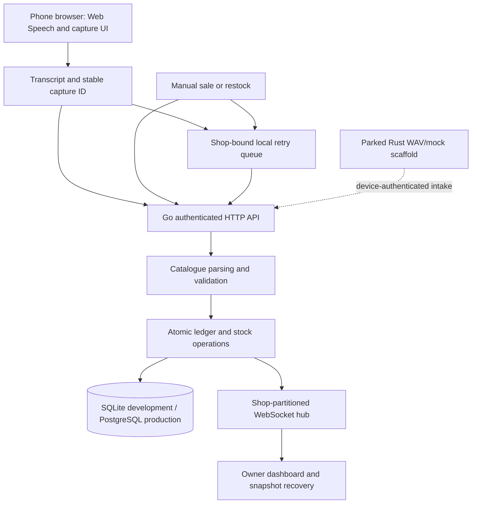

# ListenLedger — Voice-Assisted Sales and Inventory

**Authoritative product, architecture, implementation, operations and roadmap reference.**
Consolidated on **21 October 2026**, against source commit
`ce8f0572ed5564846cb67d0b56f99e6232ca9b15`. The documentation change itself does not
validate a new application release.

ListenLedger has a substantial ledger, owner dashboard and browser speech-capture
implementation. **Reliable real-shop capture, current deployment acceptance and
production readiness are not established.** Start P1 evidence collection while
completing the release and privacy work below. New application audio recording
remains disabled; the Rust edge runner remains parked.

Use the [staff guide](STAFF_TRAINING.md) for staff-facing training and the
[original blueprint](Ambient_Sales_Capture_Blueprint_v0.2.md) for product hypotheses
and long-term vision. Known inconsistencies in retained documents are recorded in
[documentation policy](#documentation-policy).

## Contents

1. [Product overview](#product-overview)
2. [Problem ListenLedger solves](#problem)
3. [Target users](#target-users)
4. [Real-world shop workflow](#shop-workflow)
5. [Current product status](#current-status)
6. [System architecture](#architecture)
7. [Backend](#backend)
8. [Frontend and F01–F45](#frontend)
9. [Recognition and parsing](#recognition)
10. [Edge system](#edge)
11. [Database and persistence](#persistence)
12. [Authentication, security and privacy](#security)
13. [Deployment architecture](#deployment-architecture)
14. [Implementation status matrix](#status-matrix)
15. [Completed implementation milestones](#milestones)
16. [Remaining P0–P7 roadmap and dependencies](#product-roadmap)
17. [Field acceptance and evidence requirements](#field-evidence)
18. [Development setup](#development)
19. [Testing and CI](#testing)
20. [Deployment and operations](#operations)
21. [Multi-agent development protocol](#multi-agent)
22. [Historical evidence and decisions](#history)
23. [Documentation policy and preservation crosswalk](#documentation-policy)

<a id="product-overview"></a>
## 1. Product overview

ListenLedger turns structured sales conversations into sales records, inventory
movements and a live owner dashboard. Its principle is **conversation becomes the
data-entry interface**. The core loop is Hear → Understand → Validate → Record →
Update. Uncertain transactions require human review.

Both sales and supplier restocking are core MVP requirements. Restock cost is
distinct from sales revenue. Future hardware may be a rechargeable counter device;
the current pilot path is a phone browser. Prove the software and shop value before
manufacturing hardware or expanding analytics.

<a id="problem"></a>
## 2. Problem ListenLedger solves

Manual POS entry, notebooks and retrospective bookkeeping take effort and leave
gaps in sales, quantities, stock and revenue. Shop conversations may already
contain the necessary information, but this must be measured rather than assumed.

The product must establish that cashier protocol compliance and speech accuracy
are sufficient, and that correction takes less effort than manual entry. Voice
capture depends on staff choosing to speak each transaction; it does not by itself
solve deliberate under-reporting or an owner–staff trust problem.

<a id="target-users"></a>
## 3. Target users

The first pilot is **one shop, one sales point, one primary cashier, one microphone
and 20–50 known products**, initially English. Target small/local retailers with
frequent verbal transactions, manageable catalogues, incomplete records and an
owner willing to participate in measurement. Nigerian shop speech, accents,
Pidgin and mixed-language conditions are evaluation concerns; support must follow
evidence.

The cashier captures sales; the storekeeper reads supplier receipts; the owner
maintains the catalogue, resolves reviews and reconciles stock/revenue. Multiple
checkout lanes, overlapping speakers, multiple counters and broad language support
are later scope.

<a id="shop-workflow"></a>
## 4. Real-world shop workflow

1. **Set up:** create an owner account, securely save the recovery code, configure
   shop currency/timezone and closing phrases, then load products, aliases,
   packaging and opening stock. Browser microphones do not require device pairing.
2. **Sell:** say “Two Milo, four thousand naira. Thank you.” Expected acceptance:
   stock 20 → 18, one NGN 4,000 sale, one stock effect, updated ledger/dashboard.
3. **Restock:** say “Three cartons of Milo, forty-five thousand naira. Stock
   received.” With 12 packs/carton, add 36 packs and record NGN 45,000 purchase
   cost. Multi-item deliveries retain separate quantities, units and costs under
   a receipt, with an intelligible total and unresolved lines.
4. **Review:** missing/uncertain anchors hold the item without changing stock or
   confirmed revenue. Confirm candidate values, edit-and-confirm, or reject.
   Correction decisions retain actor/time and original/corrected values.
5. **Recover:** use manual sale/restock entry when recognition is unavailable.
   Reuse the original request ID after a lost response; do not create a fresh ID
   for the same retry. Reverse a mistaken confirmed transaction rather than
   erasing its history.
6. **Reconcile:** compare sales and physical stock with independent records daily,
   investigate every discrepancy, and retain those records as authoritative
   throughout the trial.

Browser voice capture requires connectivity in the current path. A queue can
retain an already recognized transcript or manual entry; it cannot recognize
speech during an outage. Offline manual entry requires a previously cached
catalogue. Local storage failure can leave only a volatile memory fallback.

<a id="current-status"></a>
## 5. Current product status

The ledger, catalogue, authentication, review/manual workflow, realtime updates
and browser capture integration exist. P0a/P0b, most P4 repairs, P5.1–P5.4 and
part of P5.5/P6 are integrated. P4.5, measured confidence calibration, privacy
acceptance and the P1/P2/P3/P7 evidence chain remain open.

The source has four page routes; a dedicated Counter, Customers and Expenses route
is not registered. Customer credit, expenses, pilot training/target agreement and
cohort tools have backend implementations but are parked in the pilot interface.
Hiding controls is not API authorization.

### Status vocabulary

| Label | Meaning and required evidence |
|---|---|
| **IMPLEMENTED** | Code/configuration exists at a named revision; does not imply a passing test or release |
| **TESTED** | A named check was executed against a named revision/environment, with its result and limitations; merely finding a test file is “coverage exists” |
| **DEPLOYED** | A named revision is observed running at a named environment/URL and time; deployed behavior must still be checked |
| **FIELD VERIFIED** | A real-device/shop acceptance condition has traceable observations and, where required, labelled ground truth |
| **PENDING** | Implementation, a decision or evidence remains outstanding; say which |

TESTED does not mean DEPLOYED; DEPLOYED does not mean FIELD VERIFIED; IMPLEMENTED
does not mean production ready. Old checkbox counts and the 19 October readiness
estimate are not current product measurements.

### Immediate unresolved risks

- **P4.5:** the browser still requests one alternative, without end-to-end
  recognizer confidence propagation.
- **P5.5:** heuristic matching scores are not calibrated accuracy probabilities.
- **P6 policy authorization:** [retention handlers](backend/api/retention.go)
  authenticate a shop but mutate a shared worker whose purge spans all shops.
  A per-shop response field does not make the policy shop-scoped.
- **P6 scheduler behavior:** `UpdatePolicy` changes interval/status fields without
  resetting the ticker created by `Start`. Updates are in-memory, not persisted.
  These are source-review findings; focused runtime reproduction and repair are
  pending. Do not promise reliable dynamic interval changes.
- **Privacy:** legacy browser queue snippets, deployed deletion and owner agreement
  remain unverified. Seven days is the code default, not evidence of consent.
- **Release:** current main's inspected CI run failed; manual CI and deployed
  revision/schema/restore acceptance remain pending.
- **Coordination:** Go and Python claim tables are incompatible; historical P4.5
  ownership must not disappear during registry migration.

<a id="architecture"></a>
## 6. System architecture



The Go “orchestrator server” in older product documents means the application
backend. It is distinct from the Go **multi-agent development orchestrator** and
from the unrelated LangGraph orchestrator.

| Path | Responsibility |
|---|---|
| [backend/main.go](backend/main.go) | Configuration, HTTP/TLS serving, identity wiring, health, shutdown and retention worker |
| [backend/api/](backend/api/) | Capture, catalogue, ledger, review, settings and operational HTTP handlers |
| [backend/auth/](backend/auth/) | Owner sessions, recovery, shop resolution and browser write protection |
| [backend/models/](backend/models/) | Money, products, packaging, transactions and parked domain models |
| [backend/validate/](backend/validate/) | Spoken parsing, catalogue matching, boundaries and review classification |
| [backend/storage/](backend/storage/) | Dual-dialect persistence, migrations, transactions, transfer and retention |
| [backend/ws/](backend/ws/) | Versioned shop events, connection lifecycle and sequencing |
| [backend/eval/](backend/eval/) | Synthetic backend evaluation/reporting, not a physical pilot |
| [backend/cmd/schema/](backend/cmd/schema/) / [backend/cmd/migrate/](backend/cmd/migrate/) | Administrator schema application / transfer and reconciliation |
| [frontend/src/](frontend/src/) | Router, identity, API client, speech, queue/cache and views |
| [frontend/src/components/](frontend/src/components/) | HTML view templates |
| [frontend/test/](frontend/test/) / [frontend/tools/](frontend/tools/) | Node DOM/regression tests and browser viewport harness |
| [edge/](edge/) | Parked Rust capture/STT/queue scaffold and synthetic benchmarks |
| [scripts/](scripts/) | Database security, backup/cutover/container checks and legacy coordination helper |
| [.github/workflows/ci.yml](.github/workflows/ci.yml) | Five CI jobs |
| [Dockerfile](Dockerfile), [render.yaml](render.yaml), [docker-compose.yml](docker-compose.yml) | Production image, hosted topology and disposable local staging |

<a id="backend"></a>
## 7. Backend

### Structure and serving

[backend/go.mod](backend/go.mod) declares Go 1.25.0. The server uses standard
`net/http`, Gorilla WebSocket, `database/sql`, `mattn/go-sqlite3` and pgx.
It has structured logs, `X-Request-ID` tracing, panic recovery, bounded request
bodies, unknown-JSON-field rejection, header/read/idle timeouts and graceful
shutdown. `WriteTimeout` is deliberately zero because a whole-connection deadline
would kill long-lived WebSockets; socket writes have their own deadlines.

The dashboard, API and WebSocket endpoint share an origin. Production static
serving exposes built assets and templates rather than raw TypeScript/manifests.
`/healthz` reports process/WebSocket counters; `/readyz` pings the database.

### API map

All business access is resolved from the authenticated shop. These are source
capabilities; parked endpoints remain implemented and must not be mistaken for
approved pilot UI scope.

| Surface | Main operations |
|---|---|
| `/api/auth/*` | Signup, login, logout, session and recovery |
| `/api/products`, `/api/products/{id}` | Create/read/edit catalogue; aliases, SKU, price, packaging and thresholds |
| Product subresources | Archive/unarchive, stock adjustment, movement history, CSV/JSON import and CSV template |
| `GET /api/inventory` | Catalogue snapshot, low-stock count, search/status and pagination |
| `GET /api/transactions` | Bounded newest-first history; type/status/product/receipt/date filters, count/total and sequence cursor |
| `POST /api/transactions` | Structured transaction intake with required `Idempotency-Key` |
| `POST /api/captures` | Browser session or paired-device intake, parsing/validation and atomic receipt recording |
| `POST /api/transactions/manual` | Manual sale/restock with stable `request_id` or idempotency header |
| Transaction subresources | Confirm, edit-and-confirm, reject, reverse, decision audit and detail retrieval |
| `/api/receipts/{receipt_id}` | Receipt detail and receipt confirm/reject actions |
| `GET /api/transactions/export?format=csv` | Filtered CSV export with formula-injection protection |
| `GET /api/summary` | Shop-local daily revenue/count, review and other implemented summary fields |
| `GET/PATCH /api/settings` | Shop details, closing phrases, review threshold and recognition language |
| `/api/devices` and device subresources | Pair/list/revoke/rotate external capture credentials |
| `POST /api/settings/purge-transcripts` | Shop-scoped manual transcript/legacy-audio cleanup |
| `GET/PUT/POST /api/settings/retention-policy` | Shared retention worker policy/status; authorization/timer limitations above |
| `/api/onboarding/*` | Setup status and capture test; parked drill/training implementation |
| `/api/settings/target-gates`, `/api/pilot/*` | Parked agreement, reconciliation, discrepancy and cohort tooling |
| `/api/expenses*`, `/api/customers*` | Parked expense and customer debt-book capabilities |
| `/api/dev/seed`, `/api/dev/broadcast` | Destructive/synthetic development endpoints, enabled only by `-dev` |

### Ledger, inventory, transactions and review

The catalogue supports aliases, SKU collision checks, packaging chains, imports,
opening stock, adjustments, low-stock thresholds and archive/restore without
deleting history. Packaging validates cycles, ambiguous/unsupported paths,
non-positive factors and overflow. Historical movement guards prevent unsafe
base-unit reinterpretation.

Confirmed sales deduct base units; confirmed restocks add them. Held/rejected
captures do not apply stock effects. Receipt recording, movements and durable retry
records share a database transaction. Review resolution applies stock once and
records an immutable decision; reversals record an inverse movement with legal
status checks. Events publish after commit, so failed delivery must recover from
durable snapshots rather than retrying a committed write as a new sale.

Daily summaries use shop timezone/currency and are not restricted to the first
500 ledger entries. “Sales less expenses” excludes cost of goods sold and must not
be described as net profit. The Overview's fallback page-derived KPIs can be
incomplete when the server summary is unavailable.

The parked training drill records a pass at a synthetic score of at least 75%;
this is not evidence of real cashier compliance. Its target-agreement and cohort
tools remain parked while the pilot uses an actual owner agreement and independent
records. Query generation such as `sqlc` is an optional maintenance consideration
if query volume grows, not a pilot dependency.

### Realtime

The hub partitions clients/events by shop, uses bounded buffers, ping/pong and
slow-client eviction, and tracks dropped events. Versioned envelopes carry event
type, shop, time and sequence. Clients reject malformed/unsupported/mismatched
messages, reconnect with backoff/jitter and resync snapshots. Filter/pagination
handling, stale-response protection and ID-based replacement prevent simple
duplicate totals. Revoked/expired sessions are checked before subsequent payloads.

Hosted reconnect, mobile interruption, navigation cleanup and event-gap behavior
still require acceptance. Process-local fan-out constrains the hosting topology
to one instance until a distributed design is explicitly implemented.

### Retention and limitations

Scheduled deletion exists: default seven-day transaction transcript/audio window,
24-hour interval, startup `-retention-interval 0` to disable scheduling.
The manual endpoint accepts `retention_days` or RFC3339 `older_than` in JSON or
query parameters, with JSON precedence; omission uses the active policy window.
Ledger amounts, products and movements survive cleanup.

This does not constitute complete P6 acceptance: policy is process-wide,
dynamic timer updates have a source-identified mismatch, browser queues are
separate, and deployment must prove deletion. No measured speech-confidence,
generic offline STT, staff-role permission system or completed real-shop trial
should be inferred from backend endpoint coverage.


<a id="frontend"></a>
## 8. Frontend

### UI architecture and current routes

The frontend is a mobile-first TypeScript/HTML/CSS SPA compiled by `tsc`, with
native ES modules and hash routing. `app.ts` swaps HTML templates and emits a
mount event; `views/index.ts` mounts one controller and invokes the prior view's
cleanup. `api.ts` mirrors backend contracts; `auth.ts` manages account access;
`ws.ts` handles live events; `format.ts` handles money and DOM rendering.
Server-provided display text uses text-based insertion.

| Route | Current behavior |
|---|---|
| `#/home` | Overview, daily summary/live feed/alerts, onboarding and Counter Microphone dock |
| `#/transactions` | Ledger filters/pagination/export, Needs review tab, receipt detail, manual entry and review/reversal actions |
| `#/inventory` | Search, active/archive and stock filters, product forms, aliases, packaging, import, stock audit and movements |
| `#/settings` | Shop details, Voice settings, Account, Optional devices and Advanced/Pilot grouping |

Customers currently have dialog/controller support, not a dedicated route.
Planned `#/counter`, `#/customers` and `#/expenses` must not appear as dead links.
The intended redesign separates the cashier's Counter workspace from the owner's
Home summary. Desktop navigation uses a sidebar/account top bar; planned mobile
navigation is Home, Counter, Stock, Customers, More, with Transactions, Expenses
and Settings under More. Parked destinations remain subject to P0.

Use the existing warm off-white/white/deep-teal visual system, readable text,
restrained state colors, consistent icons and focus styling. No framework rewrite,
fabricated business data or decorative nonfunctional controls is part of this plan.

### Browser capture, offline storage and retries

`audio.ts` owns the speech listener, final-result buffer, boundary detection,
recognition language, analyser, wake lock, feedback and cleanup. Home connects
captures to the authenticated API. `offline_queue.ts` stores capture identity,
shop identity, transcript/manual payload and retry/error state; `offline_catalogue.ts`
caches products per shop.

Implemented safeguards include stable spoken/manual IDs, shop-bound reads/counts
and replay, quarantine of legacy unscoped entries, and active-identity checks
during sync. Catalogue hydration occurs while online; manual/correction forms can
use cached products when a fetch fails. The storage fallbacks are IndexedDB →
localStorage → memory; volatile storage cannot guarantee reload recovery.

Connectivity messaging stops/refuses cloud-dependent voice recognition offline
and directs the cashier to manual entry. A queued item is not server-saved.
Acceptance must exercise reload, acknowledgement loss, multiple accounts/tabs,
storage limits, login changes and reconnect on physical devices.

### Completed frontend work and acceptance boundaries

The historical tracker records F01, F02, F05, F06, F08, F27, F28, F30, F31, F34
and F36 as checked. This is not an MVP-completion percentage. Source additionally
contains F33's four Settings groups and related regression tests; its old unchecked
row should not cause reimplementation. Full usability/release acceptance remains
open. F16/F17/F19 have substantial P4 fixes on Home, but their future Counter-route
integration still needs verification.

F27 adds receipt detail and receipt confirmation; per-item correction/reversal
continues through ledger actions. F28's count hides at zero and caps at 9+.
F30 still uses the shared horizontally scrollable mobile table. F31 adds editable
packaging chains. F34 retains parked panel visibility inside Advanced/Pilot and
saves threshold changes with Save Settings. F36 supplies explicit sign-in,
create-account and recovery actions, duplicate-submit protection and replacement
recovery-code acknowledgement.

### F01–F45 roadmap

The 18 October owner decision permits the existing redesign checklist to resume
while field gates remain open; it does not waive P0 privacy/scope restrictions or
authorize unrelated milestones. Start F04 only when routes can work end to end.
“PENDING” below may mean unfinished integration/acceptance even where a foundation
already exists.

Phases: F01–F06 shared system/navigation; F07–F20 Home/Counter; F21–F25 parked
Customers/Expenses; F26–F32 Transactions/Inventory; F33–F38 Settings/auth/onboarding;
F39–F45 release acceptance.

| ID | Status | Requirement and acceptance |
|---|---|---|
| F01 | IMPLEMENTED; acceptance limits below | Define reusable colour, spacing, typography, radius, and focus tokens; unify button/input/card/badge/dialog styles. |
| F02 | IMPLEMENTED; acceptance limits below | Build the desktop sidebar and shop/account top bar with active navigation and accessible labels. |
| F03 | PENDING | Build mobile bottom navigation and More menu with safe-area spacing, usable close behaviour, and no content obstruction. |
| F04 | PENDING | Register the new page routes and lifecycle handlers; preserve old links, browser back/forward, page titles, and unknown-route handling. Do not ship dead navigation entries. |
| F05 | IMPLEMENTED; acceptance limits below | Standardize loading, empty, validation, failed-save, and disconnected states with useful recovery actions. |
| F06 | TESTED historically; repeat after changes | Verify shared shell at 360, 390, 768, and 1440px, including keyboard navigation and no page-level horizontal overflow. |
| F07 | PENDING | Present daily sales, daily expenses, outstanding customer debt, and review count with explicit time scopes. |
| F08 | IMPLEMENTED; acceptance limits below | Rename the existing sales-minus-expenses metric to "Sales less expenses" wherever cost of goods sold is excluded. |
| F09 | PENDING | Show recent activity, actionable review/low-stock alerts, and a prominent Open counter action. |
| F10 | PENDING | Collapse onboarding into a compact progress banner; remove microphone operation from Home once Counter is functional. |
| F11 | PENDING | Move the working capture flow into Counter with a prominent Start/Stop listening control. |
| F12 | PENDING | Show Stopped, Requesting permission, Listening, Processing, and Error states, readable transcript, and audio-level feedback. |
| F13 | PENDING | Show captured receipts with items, quantities, amounts, customer/supplier attribution, and recent captures. |
| F14 | PENDING | Distinguish Saved, Needs review, Cancelled, Queued on this device, Syncing, and Failed outcomes; show Saved only after server confirmation. |
| F15 | PENDING | Preserve manual entry, voice feedback, screen-awake indicators, configured closing phrases, multi-item captures and cancellation. Original customer-credit attribution requirement is deferred under P0; preserve the explanatory rejection until explicitly re-authorized. |
| F16 | Partial implementation; full item PENDING | Audit final/interim recognition and transcript accumulation; prevent duplicate submissions and preserve stable capture/idempotency IDs on retry. |
| F17 | Partial implementation; full item PENDING | Preserve and validate the existing IndexedDB queue: reload recovery, retry/error visibility, account/shop isolation, and explicit local-queue versus server-saved status. |
| F18 | PENDING | Stop recognition on leaving Counter and release microphone streams, wake locks, timers, and listeners; explain this behaviour. Do not delete queued captures during page cleanup. |
| F19 | Partial implementation; full item PENDING | Handle unsupported browsers, denied permissions, interruptions, and network failures; prevent spoken feedback from producing another capture. |
| F20 | PENDING | Add meaningful regression coverage for changed audio/capture behaviour and complete controlled browser acceptance. Record physical microphone testing separately. |
| F21 | PENDING | Promote Customer Credit Book to a dedicated page with search, balances, and clear loading/error/empty states. |
| F22 | PENDING | Provide customer detail/history navigation with registration, editing, repayment, credit entry, and write-off actions. |
| F23 | PENDING | Clearly distinguish debt-book entries from sales that also change inventory; verify supported customer/transaction links and refresh after mutations. |
| F24 | PENDING | Build the Expenses page with supported filters, totals, entry, and existing expense actions. |
| F25 | PENDING | Verify customer and expense workflows on desktop/mobile with controlled test accounts and no fake entries in real shop accounts. |
| F26 | Partial implementation; full item PENDING | Redesign transaction history around receipts, supported filters, pagination, and CSV export. |
| F27 | IMPLEMENTED; acceptance limits below | Provide receipt details with items, totals, status, transcript, customer/supplier, and supported actions. |
| F28 | IMPLEMENTED; acceptance limits below | Add the Needs review tab and navigation count; highlight uncertain fields and explain confirm/reject consequences. Needs-review tab, uncertainty highlighting and consequence text merged in PR #83; navigation count added by `8b20d8f`. Automated DOM tests only; viewport and device checks remain with F40/F44. |
| F29 | Partial implementation; full item PENDING | Preserve manual entry, correction, rejection, reversal, audit details, and live updates. |
| F30 | IMPLEMENTED; acceptance limits below | Redesign Inventory with product search, supported stock filters, Add product, desktop table, and readable mobile layout. Stock filters (low stock / out of stock, with counts for the current tab) added by `5971e56`; search, add/import and the table already existed. Automated DOM tests only; viewport and device checks remain with F40/F44. |
| F31 | IMPLEMENTED; acceptance limits below | Keep aliases, packaging, stock adjustments, editing, import/template, and archival behaviour accessible through product details or appropriate forms. Packaging editor added to the product form by `4edead0`; aliases, stock adjustments, editing, import/template and archival already existed. Automated DOM tests only; viewport and device checks remain with F40/F44. |
| F32 | PENDING | Verify transaction and inventory mutations, review decisions, pagination/filter behaviour, and WebSocket refresh. |
| F33 | Partial implementation; full item PENDING | Organize settings into Shop details, Voice settings, Account, and Optional devices. |
| F34 | IMPLEMENTED; acceptance limits below | Move technical thresholds, pilot audits, and reconciliation tools into Advanced/Pilot without removing functionality. |
| F35 | Partial implementation; full item PENDING | Explain that browser microphones do not require external-device pairing; make privacy statements match actual speech-processing behaviour. |
| F36 | IMPLEMENTED; acceptance limits below | Replace the authentication mode dropdown with clear Sign in/Create account/Recover account flows. |
| F37 | Partial implementation; full item PENDING | Preserve recovery-code, session, logout, and validation behaviour; focus onboarding on shop details, products, microphone test, and first capture. |
| F38 | PENDING | Verify accessible forms/dialogs, focus management, keyboard dismissal, and usable mobile layouts. |
| F39 | PENDING | Verify all routes, back/forward, asynchronous cleanup, and protection against stale responses. |
| F40 | PENDING | Verify 360, 390, 768, and 1440px layouts; capture desktop/mobile screenshots. |
| F41 | PENDING | Run type checks, production build, relevant frontend regressions, and all required CI jobs. |
| F42 | PENDING | Verify live Render startup and frontend assets after authorized deployment. |
| F43 | PENDING | Complete controlled hosted checks for login, Counter, transactions/review, inventory, customers, expenses, and realtime reconnect. |
| F44 | PENDING | Record real-device microphone acceptance, separately from simulated speech events and automated tests. |
| F45 | PENDING | Update README with verified completion, revision-specific evidence and remaining limitations. The former requirement to maintain a parallel tracker is superseded by the 21 October README authority decision. |

Preserve integer minor-unit money, authentication, shop isolation, API contracts
and realtime behavior. Clean up view resources without deleting queued work;
ignore stale responses after route/search changes. Only expose filters with honest
loaded-data/API scope. Keep schema/deployment changes separately claimed and
prepare migrations before dependent releases. Required browser checks are
360/390/768/1440px, keyboard operation, focus/dismissal, readable mobile forms and
no page-level horizontal overflow. Stubbed DOM or headless screenshots do not
close hosted or physical-microphone gates.

<a id="recognition"></a>
## 9. Recognition and parsing pipeline

1. Browser `SpeechRecognition`/`webkitSpeechRecognition` supplies interim and
   final text. The current implementation uses continuous listening,
   `maxAlternatives = 1` and the saved shop language (default `en-US`).
2. Interim text is display-only for capture boundaries. Final results enter a
   bounded timestamped buffer (20 utterances; default 60-second look-back) across
   recognition restarts, preserving a sale during a payment pause.
3. Sale/restock closing phrases select capture context. No-anchor closing phrases
   are suppressed; partial anchor-bearing captures remain reviewable. A stable
   browser capture ID travels in the payload and idempotency header.
4. The Go engine splits speech, handles corrections/cancellations and matches
   catalogue names/aliases before numeric parsing so number-bearing brands survive.
5. Product matching supports exact SKU/name, aliases, conservative spelling and
   Double Metaphone phonetic matching, with ambiguous matches held. Owner correction
   can optionally save the mishearing as an alias.
6. Product/quantity/amount confidence and business validation drive confirmation
   versus review; the weakest required anchor cannot be hidden by an average.
7. Accepted receipt lines commit together; results and inventory events update
   the dashboard after commit.

Confidence values are **heuristics**, not measured probabilities: an explicit
quantity commonly scores 0.98; an inferred quantity scores 0.60, below the default
0.75 review threshold. Phonetic matches use approximately 0.88–0.92; collisions
can resolve to 0.50/ambiguous. Product and catalogue-price defaults still require
calibration. Recognizer alternatives/confidence propagation and score retention
are P4.5; combining them with labelled outcomes is P5.5.

P5.2 selects the earliest unit in each parsed clause deterministically; that alone
does not prove correct quantity/unit attachment in arbitrary mixed receipts.
Cancellation now respects word boundaries and confines ambiguous “drop that” to
whole/trailing clauses. Real accents, noise, customer speech, missing anchors,
discounts and self-corrections remain evaluation requirements.

Recognition restart backoff and visible failure states replace rapid repeated
restarts. Readback suspends/aborts recognition, ignores superseded results and
resumes with bounded recovery so the phone should not recapture its announcement;
physical acceptance remains open. Grammar boosting and the decorative spectrum
were removed; remaining VAD/SNR/signal badges are explicitly UI-only.

Browser-provider speech processing may send audio off-device. No on-device/offline
recognizer has been established for the current pilot. P2 chooses engine/language
from measurements; P3 chooses ambient versus genuine hold-to-talk. A Start/Stop
toggle is not a completed push-to-talk experiment.

<a id="edge"></a>
## 10. Edge system

The Rust crate uses Tokio, reqwest/rustls, serde and a command-driven STT interface.
Implemented scaffold includes PCM/WAV framing, energy VAD helpers, bounded ring
buffers, capture session states/timeouts, boundary/anchor helpers, a file-backed
JSON-lines queue, atomic temporary-file replacement, corrupt-entry recovery,
acknowledgement-based removal, HTTP retries/backoff and health diagnostics.
Canonical device credentials and stable capture IDs connect it to `/api/captures`.

**Parked: do not run this runner against a real shop backend.** `main.rs` defaults
to mock audio and falls back to it for unknown sources. The default recognizer
can be mock; `edge/scripts/stt_runner.py` can return canned text based on WAV
duration/energy even after external inference fails. These are not acoustic
recognition results. The seven clean/noisy/negative benchmark scenarios use
synthetic fixtures.

Actual microphone driver integration, fail-closed real inference, target-hardware
benchmarking, deployed device contract acceptance, power-loss/ack-loss queue
proof and actual audio cleanup remain pending. This does not block phone-first P1.

### Configuration and parked diagnostic procedure

| Variable | Source behavior |
|---|---|
| `LISTENLEDGER_BACKEND_URL` | Defaults to `http://127.0.0.1:8080` |
| `LISTENLEDGER_DEVICE_TOKEN` / `LISTENLEDGER_DEVICE_ID` | Paired credentials/identity; demo defaults must not be used for real data |
| `LISTENLEDGER_QUEUE_FILE` | Defaults to `captures_queue.jsonl`; runner opens capacity 1,000 |
| `LISTENLEDGER_AUDIO_SOURCE` | `wav:<path>` or mock; unknown values currently fall back to mock |
| `LISTENLEDGER_STT_BINARY` / `LISTENLEDGER_STT_MODEL` / `LISTENLEDGER_STT_LANGUAGE` | External recognizer configuration |
| `WHISPER_CLI_PATH` | Optional external CLI used by the Python runner; failure can still enter canned fallback |

The old `LISTENLEDGER_MODEL_PATH` documentation is not the runner's STT-model
configuration. The command recognizer writes a temporary WAV and deletes it after
the command; “RAM only/no disk audio” is false for that path. Deletion is not
evidence of secure erasure or complete crash cleanup.

For an explicitly resumed hardware experiment, preserve the Linux diagnostic
sequence: enumerate with `arecord -l`, record a consented 16kHz/16-bit/mono fixture
using `arecord -D plughw:1,0 -f S16_LE -r 16000 -c 1 -d 5 /tmp/test_mic.wav`,
adjust levels with `alsamixer`, verify model download/checksum using
`edge/scripts/download_model.sh tiny.en`, then benchmark a verified real recognizer.
Earlier microphone suggestions (boundary/USB directional microphone, roughly
0.5–1.5m from the cashier, away from street noise) were proposals, not supported
hardware certifications. No Raspberry Pi RTF claim or generic Android hardware
support is accepted without measured hardware/model/audio evidence.

<a id="persistence"></a>
## 11. Database and persistence

### SQLite and PostgreSQL

SQLite supports local development using WAL, foreign keys, busy timeout and
immediate write transactions. Keep its database on a local filesystem with
reliable POSIX locking, not NFS/SMB/GlusterFS. It is not the production container's
fallback database.

PostgreSQL uses pgx, bounded connection pooling, placeholder rebinding and
transactional row locks. `storage.Open` selects the dialect; configured PostgreSQL
failure must fail startup. The production `OpenPostgresRuntime` path checks required
migration versions without DDL. SQLite remains supported and both dialects need
regression coverage.

Current PostgreSQL pool settings are 25 open/10 idle connections, a five-minute
connection lifetime and two-minute idle timeout. SQLite uses eight open/idle
connections. Review connection limits, query deadlines and TLS verification for
the actual hosting/provider configuration before release; source defaults alone
are not operational acceptance.

Money is stored in integer minor units, quantities in validated whole/base units,
and timestamps consistently in UTC with shop-local reporting boundaries.
PostgreSQL uses appropriate BIGINT/timestamp columns; SQLite uses sortable UTC
representations. Products/transactions and related records are shop-scoped, with
cross-shop relationship constraints and nullable unresolved product references.

### Schema inventory

There are **13 embedded migrations per dialect: 0001–0012 and 0014**, under
`backend/storage/migrations/` and `migrations_pg/`. Migration 0014 is canonical
recognition-language work from PR #56. Version 0013 is absent; do not create a
filler or another 0014.

The security setup enumerates 18 tables including migration history: owners,
shops, sessions, auth attempts, products, transactions, stock movements, ledger
requests, devices, review decisions, shop target gates, pilot reconciliations,
pilot discrepancies, cohorts, expenses and customer/debt records.
Historical eight/twelve-migration and 14/16/17-table snapshots are superseded.

Reserve a migration version before creating either dialect file. Both dialects
share the version/name; different features must never reuse it. Embedded
`schema_migrations` is the application tracker. Provider-managed migration history
must not independently replay the same application changes.

### Atomic operations and retry contract

- A receipt's ledger rows, stock effects and retry records commit together;
  a failed later line rolls the receipt back. Earlier “each line commits
  independently” descriptions are obsolete.
- PostgreSQL locks products in deterministic order; concurrent purchases must not
  oversell and concurrent review decisions must not apply twice.
- Review decisions preserve original/corrected values, actor, time and notes.
  Movements, receipt links and reversal records preserve history.
- `POST /api/transactions` requires an `Idempotency-Key` up to 128 bytes:
  first creation is HTTP 201, matching replay 200, conflicting reuse or
  insufficient stock 409.
- Spoken capture carries the browser's `capture_id` and idempotency header through
  queue retries. Intake uses anchor fingerprints; tests cover replay/catalogue
  drift. This is request-identity protection, not deduplication of all similar
  spoken phrases.
- Manual entry requires a client-minted `request_id` in the body or idempotency
  header. Keep it for online/offline retries. Fingerprinting excludes server-made
  IDs/timestamps and catalogue-price drift; replay does not rebroadcast movement.
- Preserve the same ID across ambiguous failures and any bounded retry. Exercise
  concurrency, rollback, currency/unit validation, insufficient stock, reversal,
  and reconnect at the exact candidate revision.

Backup/transfer must preserve current balances and existing movement/retry history;
never import old sales by replaying them as new stock movements.

<a id="security"></a>
## 12. Authentication, security and privacy

### Identity and access

Owner authentication is implemented by Go, not Supabase Auth. Passwords use
PBKDF2-SHA256 with random salt and 600,000 iterations. Random session tokens are
stored hashed; production cookies are Secure, HttpOnly and SameSite=Strict.
Sessions last 12 hours. Recovery rotates the private recovery code and revokes
prior sessions; email recovery is not configured.

Browser writes require the session and `X-ListenLedger-Request: 1`, with origin/
cross-site checks. Device bearer authentication is a separate capture path with
pairing, revocation, rotation and canonical-device checks. HTTP and WebSocket
identity resolve the authenticated shop rather than trusting a query-string ID.
The development `QueryShopResolver` is not the production identity configuration.

Rate limits cover authentication attempts and capture/test/drill intake; captures
use a 60-request/minute limiter. Server validation limits input sizes/values and
rejects invalid status overrides. CSV export escapes spreadsheet formula triggers.
Production supports TLS 1.2+, HSTS for HTTPS/proxy deployment, CSP, no-sniff,
frame-denial and referrer-policy headers. Credentials/transcripts should not enter
unnecessary logs.

The server-only PostgreSQL role has DML access to application tables and SELECT
access to migration history, without runtime schema creation. RLS restricts roles,
but its runtime policies allow that role access across shops: **Go shop
authorization is the tenant boundary**. Anonymous/public Data API grants must
remain revoked. Go owner IDs do not automatically correspond to Supabase Auth
`auth.uid()`.

### Current audio policy

New application snippet recording is disabled. The browser strips audio from new
uploads/queue entries, and capture intake discards `audio_data` even from old
clients. Detected credit/customer attribution is rejected before ledger writes
during P0. This does not prove current deployed behavior or erase old data.

Legacy audio can remain in transaction rows and browser queues. Ordinary transaction
JSON/WebSocket payloads omit `AudioData` and expose `has_audio`; authorized detail
retrieval can fetch legacy audio on demand. Database transaction reads still
select the audio column, so payload exclusion is not elimination of database I/O.

Manual and scheduled purges clear transaction transcript/audio fields while
preserving financial movements. They do not establish deletion from browser
storage, prior exports or backups. Agree and verify the relevant lifecycle and
access rules before claiming complete deletion.

Browser speech processing may transmit audio to the provider even though
ListenLedger creates no new stored snippets. Explain listening, stopping, cloud
processing, transcript retention and legacy data truthfully. A visible counter
notice and real owner/cashier briefing are mandatory. P1's separately consented
research recordings stay encrypted outside Git and are deleted after labelling.

Re-enabling recording is conditional on an owner decision: per-shop opt-in,
review-required captures only, separate storage, controlled retrieval, short
automatic retention, working playback after 20+ seconds and verified deletion.
Do not re-enable it merely to finish an optional feature checklist.

<a id="deployment-architecture"></a>
## 13. Deployment architecture

[Dockerfile](Dockerfile) builds frontend assets with Node 22, the CGO-enabled backend
with Go 1.25, and runs a non-root Alpine 3.22 image with certificates/timezone data.
It serves only Go plus dashboard assets/templates; it does not start the edge runner.

[render.yaml](render.yaml) defines a Docker web service in Frankfurt, a free plan,
`PORT=8080`, secret `DATABASE_URL`, `/readyz` health checking and
`autoDeployTrigger: checksPass`. These are repository configuration, not proof of
current provider provisioning or pricing. Confirm workspace, plan limits, sleep,
backup availability and costs when executing deployment; paid provisioning needs
owner authorization.

Production connects over TLS to an administratively prepared PostgreSQL database
(Supabase is the documented target), using the restricted application role.
Use provider-supplied connection details appropriate to the hosting network; do not
invent pooler hosts or assume direct IPv6 connectivity. Browser API/socket traffic
stays same-origin HTTPS. One instance is required for process-local realtime.

Docker defaults to `-frontend /app/frontend -require-postgres -skip-migrations`.
Missing schema versions intentionally prevent startup; `AUTO_MIGRATE` does not
override this. There is no automated administrator migration stage.

[docker-compose.yml](docker-compose.yml) itself supplies a disposable PostgreSQL 16
service and an app command enabling migrations/`-dev` HTTP cookies. There is no
separate committed override file. Its local credentials and settings are not a
production configuration.

A local/VM Go+SQLite topology behind a TLS proxy remains a development/reference
option, with local persistent storage and backups. It does not establish supported
shop hardware or offline browser speech.

<a id="status-matrix"></a>
## 14. Implementation status matrix

Baseline: `ce8f057`, inspected 21 October 2026. “Coverage exists” is not a new
test result; historical executed checks are in section 22. No field row is accepted by
this consolidation.

| Area | IMPLEMENTED | TESTED | DEPLOYED | FIELD VERIFIED | PENDING |
|---|---|---|---|---|---|
| Identity, catalogue, ledger, review/reversal | Yes | Automated coverage; historical passes | Current revision unverified | No accepted evidence found | Hosted owner/isolation workflow |
| Atomic receipts/manual and spoken retries | Yes | Failure/replay/concurrency coverage | Unverified | Open | Physical interruption/ack-loss checks |
| P0a/P0b | Yes | Regression coverage | Historical P0a record only | Open | P0b payload/row/device acceptance |
| P4.1–P4.4 | Yes | Listener/API/settings coverage | Unverified | Open | Phone checks; P2 language choice |
| P4.5 | Incomplete | Evaluation pending | Unverified | Open | Alternatives, confidence and retained scores |
| P4.6 | Risk not established | Physical checks pending | Unverified | Open | Verify contention before choosing a fix |
| P4.7–P4.9 | Yes | Restart/offline/queue/readback coverage | Unverified | Open | Real interruptions and cleanup |
| P5.1–P5.4 | Yes | Parser/matcher/alias regressions | Unverified | Open | Labelled real-transcript evaluation |
| P5.5 | Partial | Inferred-quantity coverage | Unverified | Open | P4.5 integration and calibration |
| P6 | Partial | Purge/worker/payload coverage | Unverified | Open | Shared-policy/timer defects, legacy queues, policy/deletion evidence |
| Frontend redesign | Partial | Dated DOM/headless results | Unverified | Open | F-roadmap integration and F39–F45 acceptance |
| Hosting/backup tooling | Yes | Automated rehearsals exist | Historical notes only | Open | Exact release, restart and restored-target acceptance |
| Edge | Scaffold | Synthetic/unit tests | Excluded from cloud image | No evidence found | Parked real hardware/inference |
| P1/P2/P3/P7 | Plans, not outcomes | Synthetic reports do not qualify | Not applicable | Open | Data, engine/mode decision and controlled pilot |

### MVP completion gates

All remain acceptance obligations even when underlying source/tests exist:

- A new owner sets up shop/catalogue/microphone without developer assistance.
- Real spoken sales and multi-line restocks produce correct receipt/stock effects.
- Failure/retry leaves one correct effect; uncertain captures remain harmless.
- Review/correction, manual fallback and catalogue operations work for the owner.
- Totals/history stay correct across filters, delayed snapshots and reconnects.
- Deployment isolation, revocation, persistence and clean restore are demonstrated.
- Traceable pilot results meet owner-agreed targets.

<a id="milestones"></a>
## 15. Completed implementation milestones

Historical milestone numbers are retained as implementation provenance, not release
certification. Their generic “COMPLETE” labels are superseded by the status matrix.

| Historical milestone | Implemented contribution | Current qualification |
|---|---|---|
| Unnumbered early foundations | Serving, catalogue, identity, atomic ledger and owner/realtime foundations | Feature inventory above; end-to-end acceptance remains |
| 5 | Synthetic evaluation/report, staff guide, imports, static serving, hub tests | Synthetic results, not shop trial |
| 6 | Event sequencing, reversals, manual entry, product movement/stock audit | Manual retry flaw subsequently fixed by P4.8 |
| 7 | Receipts, immutable review decisions, edit-confirm, device rotation, archive | Receipt/UI/device acceptance open |
| 8 | Onboarding/capture test, alias/SKU/base-unit guards, queue recovery | Pilot-specific training/device UI parked |
| 9 | Value/currency/confidence invariants, readiness/rate limits, cancellation and view cleanup | Physical capture/recovery open |
| 10 | Atomic multi-line receipts, anchor replay hashing, bounded edge sessions | Edge loop still WAV/mock |
| 11 | Sortable ULIDs, packaging stock adjustments, frontend regressions | Hardware acceptance separate |
| 12 | PostgreSQL dialect, pooling/rebinding/row locks, DATABASE_URL | Runtime deployment evidence separate |
| 13 | Transfer/reconciliation CLI, restricted-role security, Render config | Live transfer/cutover open |
| 14 | PostgreSQL CI service, concurrency tests, synthetic-report relabelling | Historical pass does not validate current head |
| 15 | WAV/command STT adapter, Rust checks, manual transcript purge | Real inference absent; retention now also scheduled |
| 16 | Direct TLS/security headers and operational notices | Notice corrections and browser-specific cleanup remain |
| 17 | Synthetic acoustic scenarios and dynamically calculated evaluation metrics | No real acoustic accuracy or operator compliance proven |
| 18 | Cashier drill, target agreement storage, PostgreSQL restore test | Tooling parked; real agreement/training still required |
| 19 | STT command diagnostic wrapper, catalogue query filters, intake tests | Canned STT fallback; no accepted hardware RTF |
| 20 | Filter/pagination-aware live updates and snapshot reconciliation | Hosted/mobile acceptance open |
| 21 | DOM UI acceptance, receipt failure and deployment-isolation tests | Simulated UI is not live browser deployment |
| 22 | Paper-vs-app reconciliation, discrepancy investigation, cohort progression | Parked; P7 uses independent spreadsheet records |
| Cloud container increment (unnumbered TODO entry) | Docker/Compose, Render alignment, connection-close/reopen cutover rehearsal | Not an abrupt live server reboot or hosted restore |
| 24 | Expenses/category summaries and sales-minus-expenses calculation | Parked; not net profit excluding cost of goods |
| 25 | Customer book/Gbese, debt/repayment/forgiveness and summaries | Parked; spoken credit rejected for pilot |
| 26 | Browser Counter dock and session-authenticated Web Speech intake | Phone/browser reliability unverified |
| 27 | Wake lock, readout and restock feedback | Inert grammar boosting later removed by P4.9 |

P0–P6 repairs and F-series work are mapped to PRs and historical checks in section 22.


<a id="product-roadmap"></a>
## 16. Remaining product roadmap: P0–P7

### Delivery rules and dependencies

The P-series is the field-facing priority order. It supersedes the old five-stage
milestone sequence. The existing frontend checklist may proceed under the
18 October owner directive, without expanding pilot scope or waiving evidence.

1. Freeze unrelated milestones. Preserve working ledger/auth/catalogue/review code.
2. For capture/parsing/matching changes, supply real-device recording/screen capture
   or measured real-transcript evidence before acceptance/merge. Synthetic
   regressions alone do not meet this rule.
3. Measure before choosing an engine, language, capture mode or broader parser.
4. Keep code, automated validation, deployment and field evidence separate.
5. Emmanuel alone accepts evidence and merges. CI blockage does not waive
   branch rules or physical/shop checks.

P1 can begin without additional application code once research arrangements are
ready. P6 policy/release work proceeds in parallel before app use. P2 depends on
P1 labels/audio; P3 follows P1/P2 and an agreed experiment. P4.5 supplies confidence
for P5.5, which also needs labelled P1/P2 outcomes. P7 requires owner preparation,
privacy/release acceptance, device checks and measured recognition/mode choices.
P5.6 is optional and must earn adoption.

The historical active P4.5 reservation is `DeepSeek-20261019-p45`, token
`af390fdfdf534215a42be13f859f08f2`. Coordinate through the owner/orchestrator;
do not infer release from its absence in a new registry. No duplicate P4.4 or
migration 0014 implementation is allowed.

### P0 — Freeze and park scope

**IMPLEMENTED:** P0a parks credit/expense KPIs/actions, edge-device UI,
training/target-gate onboarding and reconciliation/cohort panels. P0b disables
new snippet storage, strips new queue/upload audio, discards old-client audio at
intake and rejects detected credit/customer attribution before a ledger write.

**PENDING parent gate:** owner agreement on parked scope, exact-release validation,
real-device evidence and deployed behavior. Hidden UI is not an API boundary.

| Parked scope | Rule |
|---|---|
| Credit book/Gbese, spoken credit attribution | Preserve historical capabilities/data; reject credit captures clearly for the pilot |
| Expenses/profit analytics | Do not expand as an MVP requirement |
| Training simulator, agreement/cohort/reconciliation UI | Agree targets and reconcile on paper/spreadsheet |
| Rust edge/custom hardware | Phone first; no synthetic runner against real data |
| Additional database/cloud platform expansion | Maintain what one pilot needs; no unrelated migration/platform program |
| Grammar/spectral “accuracy” decorations | Removed/inert UI is not recognition evidence |
| New raw audio retention | Disabled until P6 decision and controls are ready |

### P1 — Field truth test

**PENDING; no app code dependency.**

- Obtain explicit owner consent and visible customer notice for the recording trial.
- Use an ordinary phone recorder, separate from the app, for 3–4 hours of real
  counter trading including a busy period; minimum gate is at least three hours.
- Encrypt recordings, keep them outside Git and delete after labelling.
- Label every sale: time, products, quantities, units, amount, price speaker,
  language and relevant pause/boundary timing.
- Measure sales/hour, the proportion naturally speaking all anchors, English/
  Pidgin/Yoruba/Igbo/Hausa/mixed language use, non-sale “thank you” occurrences and
  speakers, payment-to-closing pauses, and generator/traffic/music noise.
- Train one cashier in product + quantity + amount + closing phrase for one day;
  repeat recording/labelling and compare compliance, slowdown and customer friction.
- Interview the owner about current records, effort versus trust, existing
  notebook/POS/bookkeeper spending, adoption value and willingness to pay.

Deliver a labelled CSV ground-truth sheet and a one-page findings summary.

### P2 — Speech-to-text bake-off

**PENDING; depends on P1.** Compare Chrome Web Speech `en-US` (baseline), `en-NG`,
Whisper small/medium/large-v3 and a suitable Nigerian-English cloud candidate on
the same recordings. Score each transcript set through `backend/validate` against
labels: product, quantity, amount and full-transaction accuracy; include unit/
false-capture analysis, latency, cost/hour and connectivity/offline behavior.

Store anonymized text transcripts and labels as the main accuracy regression set.
Choose engine and recognition language from measured results; keep `en-US` until
that choice is evidenced. No engine or LLM is an unconditional dependency.

### P3 — Ambient versus push-to-talk

**PENDING; follows P1/P2 and owner experiment plan.** Build genuine hold-to-talk
support for the comparison; current Start/Stop continuous listening is insufficient.
Compare capture rate, clean-capture rate, cashier seconds/sale and cashier/owner
preference under the same catalogue/protocol.

The original P3 narrative proposed half a day per mode; the later field register
asked for one trading day per mode. **Duration is unresolved and must be agreed
before the experiment**, not silently declared completed. Record duration,
conditions, decision and evidence. The historical recommendation is to start with
push-to-talk unless ambient proves itself; it is not a measured mode selection.

### P4 — Browser capture pipeline

| ID | Implemented state / remaining work | Acceptance gate |
|---|---|---|
| P4.1 | Rolling final-text buffer across results/restarts implemented | Sale → 10-second payment pause → closing phrase gives exactly one correct receipt; include boundary-window pauses, restarts and consecutive customers |
| P4.2 | Browser/server no-anchor suppression and diagnostic count implemented | Ten stray “thank you” phrases yield zero reviews; legitimate partial sales remain visible |
| P4.3 | Final-only boundary, duplicate-final guard, browser capture ID and retry propagation implemented | Interim/final/replayed results and lost acknowledgement produce one ledger entry and movement on Android/iOS |
| P4.4 | Saved language, Settings control and listener/readback wiring implemented; canonical PR #56 | Persistence and actual recognizer/readback language on phones; migration 0014 deployed; default selected by P2 |
| P4.5 | Still one alternative; unfinished capture → queue → API → matcher → retained-score pipeline | Carry 3–5 hypotheses/confidence, evaluate catalogue matches, retain analysis scores; compare real misrecognitions and safe review outcomes |
| P4.6 | Analyser/getUserMedia plus recognizer remain; recorder removed | Test contention on real phones before deciding whether to remove analyser or change capture |
| P4.7 | Bounded exponential restart backoff and “not listening” state implemented | Flaky network/repeated errors, audible beeps, recovery, battery/heat and honest status over a counter session |
| P4.8 | Honest offline voice UI, manual queue IDs, shop isolation and cached catalogue implemented | Offline form opening, cached selection, durable queue/reload, lost response/concurrent replay and account/multi-tab isolation on real devices |
| P4.9 | Inert grammar/spectrum removed, UI signal labels clarified, readback guard implemented | Real sales still capture; own announcements never create another sale/restock; clean stop/navigation/wake-lock behavior |

Physical capture checks require at least two Android phones running Chrome and
one iPhone running Safari. Record exact OS/browser versions and restrict support
claims to tested devices.

### P5 — Understanding layer

Measure every change on the real P1/P2 transcript set.

| ID | Implementation / pending work | Acceptance |
|---|---|---|
| P5.1 | Catalogue-first longest name/alias masking implemented | Five Alive, Seven Up, 7Up and Three Crowns retain correct product, quantity and amount on real utterances |
| P5.2 | Earliest unit per clause selected deterministically | Verify quantity/unit associations and mixed carton/pack/bottle receipt lines and conversions; deterministic is not automatically correct |
| P5.3 | Word-bounded cancellation and whole/trailing-only ambiguous “drop that” implemented | Genuine cancellations work; “drop that bag there…” and ordinary speech do not silently remove a sale |
| P5.4 | Double Metaphone and correction-to-alias implemented | Evaluate real mishearings such as peek/Peak, alias saving and wrong confident matches; proposed false confirmations ≤1% remains unachieved |
| P5.5 | Inferred quantity lowered to 0.60 implemented; recognizer integration/calibration pending | Combine P4.5 with labelled correct/incorrect outcomes; measure false confirmations, omitted/ambiguous anchors and review effort |
| P5.6 | Optional rules-versus-LLM experiment pending | Strict JSON referencing catalogue product IDs, same real dataset, compare accuracy/latency/cost/connectivity; adopt only for a measured win and retain validation/review gate |

### P6 — Privacy and raw-audio policy

**Partial implementation.** Privacy wording/manual purge query handling, scheduled
purging and exclusion of legacy audio from ordinary JSON/WebSockets are implemented.
Do not implement those again as if absent.

Remaining work:

- Agree pilot retention/notice/access policy with the real owner; seven-day code
  defaults are not evidence of agreement.
- Reproduce/address shared-policy authorization and scheduler timer/persistence
  limitations before presenting policy control as per-shop/reliable.
- Resolve legacy server audio and browser queue snippets under the agreed policy,
  with deletion/access evidence; account for exports/backups separately.
- Verify deployed new/legacy-client payloads, empty new audio fields, controlled
  detail retrieval and actual scheduled/manual deletion.
- Correct residual staff/operational contradictions and brief staff.
- Display a truthful counter notice explaining provider processing.

Only if recording is explicitly re-enabled: per-shop opt-in, review-only snippets,
separate audio storage, controlled retrieval, short automatic retention and fresh
playback/deletion tests. Otherwise keep recording disabled.

### P7 — Controlled pilot

**PENDING.** One shop/counter/trained cashier, two weeks alongside existing records.
Reconcile ledger versus actual sales/stock daily in a spreadsheet; investigate
every difference. Record the agreed metrics and willingness to pay. Expand to
1–2 additional shops only after acceptance; approximately 5 then 10–15 shops
remain later measured stages, not achieved cohorts.

If the agreed pivot criteria are met, reuse the ledger as a tap-first POS with
voice optional. Dedicated hardware, receipt-photo OCR, more languages/speakers/
counters, cross-shop analytics, billing and integrations remain beyond this proof.

<a id="field-evidence"></a>
## 17. Field acceptance and evidence requirements

No completed field session or labelled real-counter dataset was found in the
inspected checkout. This does not prove no unreported testing happened elsewhere.
Synthetic reports and merges do not close these gates.

### Proposed targets and pivot signals

Agree targets with the pilot owner **before** scoring. The following are proposals,
not accepted commitments or achieved results.

| Metric | Definition | Proposed target | Pivot/kill signal |
|---|---|---|---|
| Capture rate | Real sales reaching ledger, confirmed or review | ≥90% | <75% after three iterations |
| Clean capture rate | Real sales correctly confirmed without correction | ≥85% | <70% after three iterations |
| False confirmations | Confirmed transactions that did not happen, including duplicates | Zero duplicates; ≤1% false | Any unresolved duplicates |
| Correction effort | Owner seconds/sale reviewing versus typing manually | Clearly less than manual entry (H6) | Equal to or greater than manual effort |
| Protocol compliance | Sales where cashier speaks all anchors | ≥85% | <60% after training |
| Willingness to pay | Owner commits to a price after pilot | Yes | No |

### Per-feature field register

**Every row remains open.** Source status is separated from the observation needed
to close it. Use an isolated test shop for destructive/error scenarios.

| Feature / gate | Current source status | Required real-world test and evidence |
|---|---|---|
| P0 pilot scope and safe intake | Parked UI and P0b guards merged | On the deployed build, confirm parked actions are hidden, credit capture explains rejection with no movement, microphone stops, and fresh/legacy-client requests retain no audio. Record release SHA and observed payload/row results. |
| P1 natural counter speech and training | No labelled real dataset in checkout | Consent and notice; record ≥3 hours including a busy period; label products, quantities, units, amount, speaker, language and timing. Compare natural speech with one trained cashier; measure compliance, friction and willingness to pay. Keep recordings encrypted and outside Git. |
| P2 recognition engine and language | Web Speech; configurable language; en-US baseline | Compare en-US, en-NG, Whisper candidates and an appropriate cloud candidate against the same P1 ground truth. Measure full-sale and per-anchor accuracy, false captures, latency, connectivity and cost. Choose the default only from measured results. |
| P3 ambient versus push-to-talk | No measured choice; current listener is continuous | Agree the comparison duration first (see P3), then compare both modes using the same catalogue/protocol. Measure capture, clean capture, correction effort and cashier preference. A Start/Stop toggle alone is not evidence of a completed push-to-talk workflow. |
| P4.1 delayed closing phrase | Rolling buffer merged | Speak a sale, wait 10 seconds, then close it; verify exactly one correct receipt. Include recognizer restarts, consecutive customers and pauses near the look-back limit. |
| P4.2 stray closing phrases | Browser/server no-anchor suppression merged in PR #65 | Verify 10 unrelated “thank you” phrases create zero review items; also test customer speech, adjacent sales and background conversations. |
| P4.3 spoken capture deduplication | Final-result gate and stable capture ID merged | Interim/final/repeated results, session restarts and an interrupted acknowledgement must produce one receipt and one stock movement per sale on each device. Include successive sales in one recognition session. |
| P4.4 language persistence | Canonical implementation merged | Change language, reload/restart, verify recognizer and readback use the saved tag on actual browsers. Attach P2 results before changing en-US default. Verify migration 0014 in the deployed schema. |
| P4.5 alternatives and recognizer confidence | Still one alternative; confidence not propagated | Implement evaluation support, then compare catalogue matching with alternative hypotheses on real misrecognitions. Confirm confidence affects review safely; do not treat heuristic scores as accuracy percentages. |
| P4.6 microphone resources | Recognizer plus getUserMedia/analyser remain; recorder removed | Start/stop repeatedly; deny/revoke permission; interrupt with a call, background the tab and lock/unlock the screen. Verify capture, truthful status, mic release and absence of resource contention. |
| P4.7 restart and error recovery | Backoff and failure state merged | Test flaky network and repeated recognition failures for a full counter session. Observe beeps, time to recovery, battery/heat and clear “not listening” feedback. |
| P4.8 offline voice messaging | Implemented; recognition still needs connectivity | Disconnect before start and mid-session; cashier must understand that queued transcripts are not offline recognition. Reconnect without creating duplicate captures. |
| P4.8 manual fallback and durable queue | Manual retry idempotency, shop isolation and offline catalogue merged in PRs #64/#66/#70 | Open the form after an outage, queue entries, kill/reopen the browser, lose a server acknowledgement and reconnect. Exactly one movement per entry, no lost durable work, truthful volatile-storage warnings, and no replay into another account/shop. |
| P4.9 simplified capture UI | Inert grammar/spectrum features removed | Verify real sales still capture and UI-only signal indicators are not understood as proof of recognition quality. |
| Voice readback, wake lock and navigation cleanup | Controls implemented; readback recapture guard merged in PR #72; physical behaviour unverified | With readback enabled, verify it cannot trigger a second sale/restock. Navigate away, background/foreground and stop; check streams, recognizer, wake lock and timers are released or recovered as promised. |
| P5.1 number-bearing product names | Catalogue-first parsing merged in PR #68 | Measure Five Alive, Seven Up, 7Up and Three Crowns on real audio/transcripts, with quantity and price variants. Verify exact product, quantity and amount. |
| P5.2 units and multi-line restocks | Deterministic per-clause unit selection merged in PR #67 | Speak mixed carton/pack/bottle receipts; verify quantity/unit associations, each line, conversion, supplier, receipt total and purchase cost. No silent partial receipt or sales-revenue inflation. |
| P5.3 cancellation | Word-bounded matching and whole/trailing-only “drop that” merged in PR #67 | Separate genuine cancellations from “drop that bag there…” and other ordinary speech. Verify cancelled/unrelated phrases never remove a genuine sale silently. |
| P5.4 phonetic matching and aliases | Implemented in code + tests: Double Metaphone matcher (0.88–0.92) and review correction-to-alias learning workflow | Real-world field evaluation open: test real mishearings such as “peek”/Peak on physical phone counter captures; verify owner's alias saving and measure wrong confident matches as well as successful matches. |
| P5.5 confidence and review thresholds | Inferred-quantity score lowered in PR #71; recognizer confidence and calibration remain unfinished | Label correct/incorrect outcomes and calibrate review thresholds. Check omitted quantities and ambiguous anchors. Measure false confirmations and review effort, not just aggregate parser accuracy. |
| P5.6 optional LLM extraction | Comparative experiment pending | Compare rules with strict catalogue-ID JSON extraction on the same real set, including latency/cost/offline effects. Adoption is conditional on a measured win, not an MVP requirement by itself. |
| Owner onboarding, catalogue and review | APIs/UI and automated coverage exist | A new owner loads 20–50 products/opening stock, sets packaging/aliases, corrects/rejects/confirms a capture, records manual sale/restock and reverses an error without developer help. Compare resulting stock/revenue with independent records. |
| Realtime, account isolation and recovery | Backend foundations and regression tests exist | Use two real accounts/devices; test login/recovery/logout, stale sessions, disconnect/reconnect, filters and daily totals. Check local queue isolation separately from server authorization. |
| P6 notices, retention, deletion and access | New recording disabled; manual/scheduled purge and JSON payload exclusion implemented; policy/timer defects, legacy browser handling and deployed verification remain | Agree the pilot policy, give staff truthful instructions, show notice, exercise deletion/access controls and prove legacy audio is handled. If retention stays disabled, do not re-enable it merely to complete optional opt-in recording work. |
| Hosted operation and recovery | Deployment/backup tooling exists; current live state unverified | Verify exact deployed SHA, HTTPS/assets, readiness, schema 0014, restricted role, restart persistence, backup restoration and outage recovery in an isolated environment. Do not equate a historical /readyz 200 with this acceptance. |
| P7 two-week controlled pilot | No completed field evidence rows | One shop/counter/cashier beside existing records; daily sales/stock reconciliation, all discrepancies investigated, metrics and willingness to pay recorded. Expand only after agreed targets pass. |

### P0b release procedure

1. Record candidate SHA, time and phone/OS/browser; screen-record Start Listening
   → test sale → Stop Listening. Verify transcript and microphone release.
2. Inspect the request for absence of `audio_data` and the new server row for
   empty audio, correct receipt and correct stock effect.
3. Queue/reconnect a fresh transcript and a legacy queued item containing audio;
   verify replay contains no audio.
4. Submit an old-client snippet payload; verify discard while retaining transcript.
5. Try spoken credit and explicit customer attribution; expect explanatory
   rejection with no ledger/stock write.
6. Attach privacy-safe screen capture and observations. Leave P0 open until
   physical evidence, candidate validation and deployment checks are complete.

### Evidence format and acceptance

Each record needs session/date, owner/cashier preparation, exact deployed commit,
device/OS/browser, engine/language/mode, catalogue version, noise/connectivity,
ground-truth counts, measured results, failures and corrective actions. Report
numerator/denominator/sample size for capture, clean capture, product/quantity/
unit/amount accuracy, false confirmations, duplicates and compliance. Record
correction time and end-to-end latency, including recognition, not just handler
latency. Link anonymized labels and summaries, never raw customer audio in Git.

| Session/date | Shop reference | Hours | Ground-truth sales | Revision/device/engine/mode | Capture/clean capture | False/duplicates | Labels, failures and acceptance |
|---|---|---|---|---|---|---|---|
| No accepted session recorded at this baseline | — | — | — | — | — | — | PENDING |

A changed implementation requires renewed verification of affected scenarios.
A fix is accepted only after the failed scenario is rerun; a historical CI pass
or `/readyz` 200 cannot substitute.

<a id="development"></a>
## 18. Development setup

Prerequisites: Go compatible with the module's `go 1.25.0` declaration, a C
compiler for CGO/SQLite, Node/npm (Node 22 matches frontend CI/image), and Git.
Rust/Cargo is needed only for edge checks/builds. Python runs coordination checks;
Docker and PostgreSQL client tools support database/container rehearsals.
Toolchain differences in CI are listed in section 19.

From the repository root:

```sh
cd frontend
npm ci
npm run typecheck
npm run build
```

In another terminal:

```sh
cd backend
go run . -addr 127.0.0.1:8080 -dev
```

Open `http://127.0.0.1:8080/`, create an account and save the private recovery code.
Without `-db` or `DATABASE_URL` the backend uses a local SQLite database.
Local HTTP needs `-dev` for non-Secure cookies. Never expose development mode to
production or valuable accounts.

For disposable local PostgreSQL staging, `docker compose up --build` uses the
committed Compose file. Review its ports/volumes before running; do not confuse
this with restricted-role production startup.

### Configuration reference

| Setting | Purpose / source behavior |
|---|---|
| `-addr` / `PORT` | Listen address; hosting PORT supplies the default port |
| `-db` / `DATABASE_URL` | Explicit SQLite path or PostgreSQL DSN; flag takes precedence |
| `-frontend` | Frontend web root, default `../frontend` from backend directory |
| `-dev` | Development endpoints and non-Secure local cookies |
| `-require-postgres` | Refuse missing/SQLite production target |
| `-skip-migrations` | PostgreSQL runtime schema verification without DDL |
| `-allowed-origins` / `ALLOWED_ORIGINS` | Additional WebSocket origins; normally leave same-origin |
| `-tls-cert` / `LISTENLEDGER_TLS_CERT`; `-tls-key` / `LISTENLEDGER_TLS_KEY` | Both required for direct TLS; HTTPS proxy hosting is also supported |
| `-retention-days` / `RETENTION_DAYS` | Default seven days; valid environment value overrides parsed flag in current code |
| `-retention-interval` / `RETENTION_INTERVAL` | Default 24h; startup zero disables worker; environment value can override flag |

Do not put DSNs/tokens in committed files, frontend bundles, logs or screenshots.
Use separate administrator and runtime credentials.

### Optional destructive demo seed

Only for disposable data: obtain the signed-in shop ID from
`GET /api/auth/session` and replace `YOUR_SHOP_ID`:

```sh
curl -X POST 'http://127.0.0.1:8080/api/dev/seed?shop_id=YOUR_SHOP_ID'
```

**This unauthenticated development endpoint deletes that shop's existing data
before inserting examples.** It is unavailable without `-dev`. Never run it
against live data.

### Root tasks

`make build` builds frontend/backend and edge if Cargo exists; `make test` runs
backend race/frontend and optional edge tests; `make check` runs Go format/vet,
frontend typecheck and optional Cargo check. Other targets are `dev`,
`verify-backup`, `verify-cutover`, `eval` and `trial`. `make clean` deletes generated
artifacts and matching root database files, so inspect the target before using it.

<a id="testing"></a>
## 19. Testing and CI

### Checks and coverage

| Layer | Commands / coverage |
|---|---|
| Go | From `backend/`: `gofmt -l .`, `go vet ./...`, `go test -race ./...`, `go build ./...` |
| Frontend | From `frontend/`: `npm ci`, `npm run typecheck`, `npm run build`, `npm test` |
| Edge | From `edge/`: `cargo fmt --check`, `cargo clippy -- -D warnings`, `cargo test` |
| Migration coordination | `python3 scripts/agent_coordination.py migrations`; `python3 -m unittest discover -s scripts -p test_agent_coordination.py` |
| Container | Build the production Dockerfile; run `scripts/ci_container_smoke.sh` with the disposable PostgreSQL container ID as CI does |
| Browser layout | `frontend/tools/shell_viewport_check.mjs`; inspect its environment/setup and record stubbed versus live API use |
| Restore/cutover | `scripts/verify_backup_restore.sh`, `scripts/verify_postgres_backup.sh`, `scripts/verify_cutover.sh`; limitations below |

Coverage includes migrations/repeat execution/constraints, authentication/recovery/
revocation, shop isolation, product packaging and imports, stock/receipt rollback,
overselling/concurrent reviews, retry conflicts/acknowledgement loss, daily totals
beyond 500 records and timezone boundaries, transfer/reconciliation, WebSocket
sequencing, frontend filters/forms/offline queues, capture/parser regressions,
retention and restricted container restart.

At the recon baseline there are 45 Go test files and 22 frontend `*.test.mjs` files.
Counts are inventory, not a pass or completeness metric.

### Test limitations and side effects

- Frontend tests primarily use simulated DOM, fetch and recognition events.
  `ui_acceptance.test.mjs` is not hosted end-to-end browser evidence.
- PostgreSQL integration requires an isolated `TEST_POSTGRES_URL`. Tests may skip
  when absent or unreachable; inspect skip output before claiming PostgreSQL tested.
  Never point destructive fixtures at a real shop database.
- The evaluator's `Test` writes `TRIAL_REPORT.md`. Full Go tests, `make test`,
  `make eval` and `make trial` can therefore modify a tracked file. Reserve scope
  or use a disposable verification copy; inspect the resulting diff.
- `TRIAL_REPORT.md` measures synthetic in-process HTTP/ledger scenarios and excludes
  physical microphones, real STT and shop noise/operator behavior. Current evaluator
  handles negative scenarios and calculates metrics; old statements that it always
  skips them or uses fixed constants are superseded.
- Backup scripts can run fixture tests when a database target is missing and still
  print “PASSED”. The SQLite fallback contains a machine-specific Go binary path;
  PostgreSQL/cutover helpers also contain local-path fallbacks. Inspect prerequisites,
  actual target, skips and assertions. Those messages do not prove hosted restore.
- The “cold reboot” storage test closes/reopens connections; it is not abrupt
  process/power-loss evidence. Container restart checks are separate.
- No dedicated Markdown lint/link CI job was found at this baseline. Documentation
  changes need link/anchor/coverage checks, `git diff --check` and diff/scope review.

### CI configuration and current evidence

[CI](.github/workflows/ci.yml) has five jobs: coordination, backend with PostgreSQL
17, frontend on Node 22, edge, and container with PostgreSQL 17. It triggers for
pull requests and pushes to `main`, `feat/**`, `fix/**` and `docs/**`.
`agent/**` pushes alone are not included.

Backend CI requests Go `1.27.x` while the module declares 1.25.0 and Docker builds
with 1.25. This difference needs validation/alignment; this README does not assert
that the configured toolchain job ran successfully.

On 21 October recon, exact-main [run 39409727078](https://github.com/eeyung1/listenledger/actions/runs/39409727078)
for `ce8f0572ed5564846cb67d0b56f99e6232ca9b15` reported **failure in all five jobs**.
Repository handovers report GitHub billing blockage; the available connector could
not retrieve annotations to independently confirm that run's cause. No rerun was
requested. Historical passes belong only to their recorded revisions.

**Manual CI pending.** The former manual procedure at
`/tmp/listenledger-ci-jobs-guide/CI_jobs.md` was absent during recon. Recover or
reconstruct it from the workflow before testing elsewhere; no runner registration
is needed to execute equivalent jobs manually. Record full SHA, commands,
toolchains/services, results, skips, failures and artifacts. Manual results do not
change GitHub badges or bypass branch rules. A new commit needs renewed checks;
Emmanuel accepts evidence and merges.

The recon itself ran migration parity and eight Python coordination tests
successfully. It did not run the application suites, PostgreSQL/container checks,
physical browsers or field sessions. Python helper tests do not establish Go
orchestrator compatibility.


<a id="operations"></a>
## 20. Deployment and operations

These procedures are acceptance requirements, not a claim that deployment or
restoration was performed during documentation consolidation.

### Administrator initialization and release ordering

1. Identify the tested revision and review schema compatibility with the running
   application. Validate both dialects on isolated databases.
2. Supply an administrator PostgreSQL URL securely, outside shell history/Git.
   From repository root, apply pending embedded migrations and security setup:

```sh
# DATABASE_URL is supplied securely for the migration administrator.
(cd backend && go run ./cmd/schema)
psql "$DATABASE_URL" -v ON_ERROR_STOP=1 -f scripts/supabase_setup.sql
```

3. Verify required versions, RLS and runtime grants. The idempotent security script
   checks expected tables, revokes PUBLIC/anon/authenticated access, and gives
   `listenledger_app` DML except read-only migration history. Newly created roles
   are NOLOGIN; provision a strong runtime password and enable LOGIN through a
   secure administrative channel.
4. Prepare schema before Emmanuel merges/deploys dependent code. Incompatible
   migrations require a staged compatibility plan.
5. Deploy with the restricted role and `-require-postgres -skip-migrations`.
   Do not fix missing-schema startup by granting runtime CREATE/DDL.
6. Verify the exact deployed SHA, HTTPS/assets, readiness and flows below.

For connector-based administrative execution, use the exact pending embedded SQL
in order, record application versions and apply security changes transactionally.
Keep provider migration history distinct; do not introduce a competing migration
authority.

Confirm hosting workspace/approved plan, configure secrets over TLS, and inspect
Data API exposure/security-advisor findings before release. Use provider connection
details that work from the hosting network. No automatic administrator migration
stage exists. Missing migrations may appear as a port-scan timeout because the
application exits before listening.

### Existing-data transfer and cutover

First determine whether valuable SQLite data exists and where. No real source
was identified in the historical deployment increment; an empty destination is
not proof of source absence.

1. Take and verify a consistent source backup.
2. Rehearse on an isolated source copy and PostgreSQL target. The CLI supports
   `-src`, `-dst` (or destination `DATABASE_URL`), `-dry-run` and `-json`.
   From `backend/`, with an isolated administrator destination URL:

```sh
go run ./cmd/migrate -src /path/to/source-copy.db -dry-run -json
```

3. **Dry-run limitation:** transfer data rolls back, but the CLI first opens both
   stores through `storage.Open`, which may initialize/migrate schemas. Do not
   assume every operation is read-only; rehearse on copies.
4. Transfer in dependency order, preserving IDs/timestamps, ownership, credentials/
   sessions, balances, receipts/reviews/movements, devices and retry history.
   Do not apply historical stock movements again.
5. Compare table counts, foreign keys, per-shop product/stock sums, revenue,
   purchase costs, expenses/debt where present, reviews and retries. Check timezone
   and integer-money boundaries. Investigate old prototype discrepancies.
6. Pause source writes/uploads, preserve local queued captures, take the final
   snapshot, import/reconcile, then switch to the tested destination.
7. Protect the old source until acceptance and retention decisions are complete.
   Never seed demo accounts/transactions into the live destination.

Before destination writes, rollback may return to the untouched source. After new
writes, reverting to old SQLite loses them: pause, preserve destination data and
recover forward or use a rehearsed reverse transfer/reconciliation. Never operate
both as independent writable authorities.

### Deployment verification register

All current-release rows are **PENDING** until evidence is recorded.

| Check | Required observation |
|---|---|
| Release identity | URL/environment, exact SHA, timestamp and image/config identity |
| Database startup | Restricted runtime connects over TLS; all required versions including 0014; missing versions fail without DDL |
| HTTPS/static assets | Dashboard/templates/modules load; no unintended source/config exposure; development endpoints disabled |
| Accounts/isolation | Signup/login/logout/recovery/revocation; two shops cannot read/write/receive each other's records |
| Owner workflow | Manual sale/restock, catalogue/packaging, review/correction/rejection, receipts and reversal reconcile |
| Realtime | Events, reconnect, stale/filter/pagination behavior and session expiry |
| Persistence | Restart/redeploy retains accounts, stock, ledger, decisions and retry records |
| Recovery | Clean isolated restore, application access and reconciled totals; source transfer if applicable |
| Privacy | Fresh/old-client audio discard, legacy-detail access and actual scheduled/manual deletion |
| Capture | Physical-device field register passes; deployment alone is insufficient |

### Backups and restoration

Protect backups as sensitive business/authentication data. Agree schedule,
retention, access and restore responsibilities. The repository contains scripts,
not evidence of an installed production backup schedule.

SQLite supports consistent online `VACUUM INTO` snapshots on local storage.
Hourly cron/systemd scheduling in the runbook was an example. Choose an unused
destination:

```sh
sqlite3 /path/to/listenledger.db "VACUUM INTO '/protected/backups/listenledger-snapshot.db';"
./scripts/verify_backup_restore.sh /path/to/listenledger.db
```

The script makes temporary snapshots, runs integrity checks and compares table
counts. It removes its temporary directory: it is **verification, not a retained
backup service**. Comparison against a changing live source can race with writes;
reconcile a stable snapshot or pause the comparison source.

To restore: stop the writer; preserve the damaged database and relevant WAL/SHM
state; restore a verified snapshot into a clean location; run
`PRAGMA integrity_check`; start the intended schema/runtime; verify identity,
balances, history and queued replay. Do not overwrite a live SQLite database or
assume an old backup contains post-backup sales.

For PostgreSQL, choose logical/provider backup and verify actual plan availability;
do not assume PITR or paid features. Restore into an isolated target and reconcile
through the application. `verify_postgres_backup.sh` and
`TestPostgres_BackupAndRestoreVerification` are tooling, not a live provider
restore record. Inspect skips/fallback execution. `verify_cutover.sh` combines
these with storage lifecycle tests; its “abrupt reboot” success text overstates
the connection-reopen test.

### Retention operations

`GET /api/settings/retention-policy` reports window, interval, last run/error/count
and next-run fields; account for the timer mismatch. The first default sweep is
after the interval, not immediately at startup; daily sweeps are not an exact
seven-day deletion deadline.

Manual `POST /api/settings/purge-transcripts` accepts
`{"retention_days":7}`, `{"older_than":"<RFC3339>"}`, or matching query parameters,
with body precedence. It clears older transaction transcript/audio for the
authenticated shop while preserving financial movements. Omission uses the active
window.

Policy updates currently affect a process-wide worker. Do not document them as
independent per-shop administration until P6 authorization/design is repaired.
Startup `-retention-interval 0` disables the worker; this is an explicit policy/
deployment choice, not a substitute for required retention enforcement.

### Monitoring and incident recovery

| Signal/problem | Action and verification |
|---|---|
| `/healthz` | Inspect `ws_clients` and `ws_events_dropped`; liveness is not database readiness |
| `/readyz` 503 | Inspect database reachability/credentials/schema and startup logs; preserve privilege separation |
| Request failure | Correlate `X-Request-ID` with logs; distinguish uncommitted failure from lost acknowledgement; retain retry ID |
| Dropped events | Inspect clients/network/backpressure and snapshot resync, not only reconnect |
| Unsupported/denied microphone | Check browser features/permissions/secure origin; show truthful state and use manual entry |
| Browser outage | Stop voice, use cached-catalogue manual entry, inspect queued-versus-saved state and replay original IDs |
| Readback/call/background/lock | Verify truthful recovery, mic/wake-lock cleanup and no duplicate capture |
| Queue/storage pressure | Preserve pending work; identify persistent versus memory storage, account binding and quota/error behavior |
| Retention failure | Inspect errors and actual rows; repair policy/scheduler and verify deletion without changing finances |
| Parked hardware experiment | Check USB/`arecord`, model/checksum, memory/disk/network and queue; never accept canned STT as recovery |

The old “continue speaking offline” advice applies only to a future verified local
recognizer. It is wrong for the current browser. Health flags and “guaranteed no
loss/duplicates” prose are not physical-failure evidence.

<a id="multi-agent"></a>
## 21. Multi-agent development protocol

### Authority and isolation

Read this README, applicable [AGENTS.md](AGENTS.md), and the **primary checkout's**
`multi-agent-orchestrator/coordination.md`, `resolution.md` and `agentmeeting.md`
before work. They are shared state, not independent worktree copies. Refresh
remote refs and logs before selecting/claiming work.

The Go development orchestrator owns registered sessions/claims. Use its approved
workflow for atomic acquisition/checking, heartbeats, handover and release.
A prose standup, stale heartbeat or absent row in a new registry is not ownership.

- Work only in an isolated assigned branch/worktree. Never switch branches, stage,
  reset or commit in the shared primary checkout.
- If registered already, do not create another session/branch/worktree/claim.
  Scope expansion must be explicitly acquired before editing. Verify token,
  identity, worktree and every path each edit/commit cycle.
- Heartbeat each cycle through the approved orchestrator interface. If unavailable,
  report the limitation; do not invent a compatible command or edit shared rows.
- Reserve every edited file/directory and migration number. Overlaps/duplicate
  feature ownership must fail. Migration reservations survive release and are
  never recycled; both dialects share a version.
- Pre-tool/legacy ownership stays binding. Request registration/handover through
  the orchestrator for active unregistered owners. Explicit owner authorization,
  recorded handover and release of old ownership precede reassignment.
- Never alter another agent's claim, infer permission from silence or run the
  unrelated orchestrator.

### Go/Python compatibility blocker

`scripts/agent_coordination.py` predates Go sessions. It resolves the primary
checkout, locks through the OS and atomically replaces logs. Its exact table header
is Feature/Agent/Token/Worktree/Scopes/Migration/Status/Heartbeat. The Go table is
Token/Agent-session/Feature/Scope/Claimed UTC.

On 21 October, a read-only probe found the Go token present but **zero rows**
recognized by Python. Python could miss Go conflicts and append a second table;
its check/heartbeat/release cannot validate the Go token. A shared lock between
implementations has not been established. Do not silently mix them.

The owner explicitly authorized the existing session's README expansion through
the Go registry, superseding creation of a Python claim for this assignment.
Future mixed-tool work still needs protocol reconciliation, including migration
reservations and historical P4.5 ownership.

Python's `migrations` command validates the checkout independently of claim
mutation. Its unit tests use disposable fixtures; passes do not prove Go
interoperability.

Shared logs require the approved serialized mechanism: reread inside the lock,
preserve other rows, atomically write and append corrections rather than rewrite
history. Legacy helpers are `locked(shared_root(...))` and `atomic_write`;
do not assume they authorize Go-managed state mutation. Report blockers/handover
to the orchestrator; release only after the resolution record.

### Validation, PRs and merging

1. Edit only claimed paths, preserving others' work.
2. Run relevant checks; inspect full diff and `git diff --check`. Stage explicit
   owned paths and inspect staged diff. Validate migration parity before committing
   migration changes.
3. Normally push the feature branch and open a PR; report full SHA, scope, checks,
   failures, skips and remaining evidence. A session-specific stop-before-push
   instruction takes precedence.
4. Inspect exact-head checks. Do not repeatedly rerun known billing failures or
   label blocked checks green. Follow manual CI requirements in section 19.
5. **Only Emmanuel accepts evidence and merges to main.** Manual results and green
   checks do not bypass branch rules or field gates.
6. Record resolution/handover, verify merged/deployed revision when assigned, then
   release through the orchestrator.

This consolidation requires a local reviewable diff and preservation crosswalk.
The owner subsequently authorized retirement of the six superseded documents
listed in section 23, after a final preservation check. Stop for review without
committing, pushing or merging. Do not add a Codex co-author trailer, per the
existing frontend contribution decision.


<a id="history"></a>
## 22. Historical evidence and important decisions

These records are provenance, not current acceptance. Past tests were not rerun
by copying their reports. Historical `/tmp` artifacts may no longer be available.

### Product and release decisions

| Date/baseline | Decision or evidence | Present interpretation |
|---|---|---|
| Blueprint v0.2 | Structured sales/restocks, H1–H6, software first and later rechargeable hardware | Standalone original vision; engine/mode remain measured choices |
| 16 October review `db85661`, merged #42; references checked at `72af068` | P0–P7 freeze and field-first priority | Supersedes old milestone order; later fixes supersede old defect descriptions |
| 18 October owner directive | Resume existing frontend redesign alongside field gates | No unrelated scope or waiver of privacy/device/evidence requirements |
| PR #56 `56166be`, merged `19e3287` | Canonical recognition-language implementation | Duplicate Codex version withdrawn; only canonical 0014; en-US pending P2 |
| 19 October audit `4337c78` | Historical readiness estimates and reproduced defects | Not current completion percentages |
| 20 October reconciliation `7d143dc` then `22a32b5` | P4/P5 repairs, P5.4, retention/payload and Settings integrated | Verify remaining gates rather than duplicate implementation |
| 21 October source `ce8f057` | Recon compared code, documents, CI and coordination | Documented baseline; no new app/deployment/field acceptance |
| 21 October owner decision | README sole product/technical/roadmap authority; retain staff guide and original blueprint | Sources stay until crosswalk review and explicit deletion authorization |
| 21 October final consolidation authorization | Existing Go session acquired all six source-document scopes; owner authorized retirement after a final comparison | Preservation verified before deletion; README owns the consolidated guidance; standalone documents retained unchanged; subsequent reference cleanup authorized for AGENTS and 10 other files |

### Capture/parsing repair provenance

| Item | Failure and implemented repair | PR/commit |
|---|---|---|
| P0a | Park distracting UI, preserve backend/data | [#47](https://github.com/eeyung1/listenledger/pull/47), `a0adf3299b1cba77da2f1fe06bec479d908f9f24` |
| P0b | Stop new snippets; reject credit before ledger effects | [#48](https://github.com/eeyung1/listenledger/pull/48), `1208fb7`; `fix/p0-disable-audio-retention` |
| P4.1 | Payment pause lost anchors → rolling buffer | [#49](https://github.com/eeyung1/listenledger/pull/49), `93c2497` |
| P4.2 | Stray closing caused review noise → no-anchor suppression | [#65](https://github.com/eeyung1/listenledger/pull/65), `5b14653` |
| P4.3 | Interim/final repeats → final gate and stable capture ID | [#51](https://github.com/eeyung1/listenledger/pull/51), `bd1a918` |
| P4.4 | Hard-coded language → persisted tag | [#56](https://github.com/eeyung1/listenledger/pull/56), `56166be` |
| P4.7 | Rapid restart loop → backoff/failure state | [#50](https://github.com/eeyung1/listenledger/pull/50), `6839f74` |
| P4.8 offline UI | Queue confused with offline STT → honest connectivity | [#52](https://github.com/eeyung1/listenledger/pull/52), `6cc3d51` |
| P4.8 manual retry | Initial queue lacked stable server identity → durable request_id | [#55](https://github.com/eeyung1/listenledger/pull/55) `b31b58f`; [#64](https://github.com/eeyung1/listenledger/pull/64) `2e2b3a3`; `fix/p48-manual-retry-idempotency` |
| P4.8 isolation | Queue replayed under another shop → scope/quarantine/identity checks | [#66](https://github.com/eeyung1/listenledger/pull/66), `648c2e7`; `feat/p4-8-queue-shop-isolation` |
| P4.8 catalogue | Offline manual form required fetch → durable shop cache | [#70](https://github.com/eeyung1/listenledger/pull/70), `e792480`; `feat/p4-8-offline-catalogue` |
| P4.9 | Inert grammar/spectrum removed; readback guarded | `feat/p4-9-remove-inert-accuracy-features`; [#72](https://github.com/eeyung1/listenledger/pull/72), `a7a540c` |
| P5.1 | Number-bearing brand corruption → catalogue-first masking | [#68](https://github.com/eeyung1/listenledger/pull/68), `b9cb0a1` |
| P5.2/P5.3 | Map-random unit / eager cancellation → text order/boundaries | [#67](https://github.com/eeyung1/listenledger/pull/67), `e85c055` |
| P5.4 | Spelling-only misses → phonetics/correction alias | [#73](https://github.com/eeyung1/listenledger/pull/73), `c0b85b3` from `2b12af0`; manual CI/field calibration pending |
| P5.5 | Inferred quantity scored as spoken → score 0.60 | [#71](https://github.com/eeyung1/listenledger/pull/71), `cfc9c58` |
| P6 instructions/purge | Cloud-processing wording and query cutoff corrected | [#69](https://github.com/eeyung1/listenledger/pull/69), `5cee064`; residual staff contradictions remain |
| P6 payload | Routine legacy audio → JSON exclusion/detail retrieval | [#75](https://github.com/eeyung1/listenledger/pull/75) |
| P6 schedule | Manual-only cleanup → background worker | [#77](https://github.com/eeyung1/listenledger/pull/77); policy/timer limitations remain |
| Settings groups | Shop/Voice/Account/Optional-device organization exists | [#79](https://github.com/eeyung1/listenledger/pull/79); `settings.html` / `settings_organization.test.mjs` |

### Historical audit probes and superseding fixes

The 19 October audit used `4337c78` and isolated synthetic probes, not real
accounts or field recordings.

| Probe | Observed then | Current interpretation |
|---|---|---|
| Repeat same manual two-pack request, opening stock 20 | Two 201s/different IDs, stock 16 | #64 repaired retry identity; phone ack-loss gate remains |
| Two shops' queue entries, one sync | Both posted with current identity | #66 repaired scoping; multi-tab/device acceptance remains |
| Offline manual form | Catalogue fetch blocked entry | #70 cached catalogue |
| “Two Five Alive, one thousand naira” | Product Alive, quantity 1, ₦2,500 | #68 regression repair; real speech unmeasured |
| “Two Seven Up…” / “Two Three Crowns…” | Product Up / Crowns | #68; numeric “7Up” already passed that specific old probe |
| “Milo, four thousand naira” | Quantity 1 treated as found/high confidence | #71 inferred marker/score; full calibration pending |
| “Drop that bag there, two Milo…” | Incorrect cancellation | #67; real boundary gate remains |
| Same mixed carton/pack clause, 200 parses | Carton 64, pack 136 | #67 deterministic selection; diagnostic counts, not field probabilities |
| “Thank you” alone | Unintelligible-speech review | #65 suppression; device zero-noise-review gate remains |
| Legacy privacy/purge behavior | Audio selectable; no scheduler; ignored query cutoff | #69/#75/#77 supersede portions; browser legacy/policy/deployment gaps remain |

The audit estimated about 55% readiness (45% remaining, 40–50% judgment range).
Its weighted 55.5/100 was ledger 20×90%, UI 15×80%, capture 25×50%, offline
10×40%, privacy 10×40%, hosting 10×50%, field 10×0%. Supervised-trial readiness
was about 70% from four equal estimates 90/50/50/90; the last credited the written
plan, not completed preparation. P1 needed no app engineering but required
consent/notice/storage/labels. Frontend 7/45 and README 167 checked/21 unchecked
were historical overlapping inventories. **None is a current measured completion,
labor estimate or delivery forecast.**

### Historical validation and deployment

- `322d1c7`: [CI 38402269349](https://github.com/eeyung1/listenledger/actions/runs/38402269349)
  recorded Go format/vet/race/build, frontend checks and Rust tests.
- Documentation PR #9: [push 38425007687](https://github.com/eeyung1/listenledger/actions/runs/38425007687)
  and [PR 38425057562](https://github.com/eeyung1/listenledger/actions/runs/38425057562)
  recorded passes.
- 15 October baseline after #28 `54b1f67`:
  [CI 38725198112](https://github.com/eeyung1/listenledger/actions/runs/38725198112)
  recorded backend/frontend/Rust validation.
- 16 October Render `d15512a` failed on missing migration 12, then fallback DDL
  hit SQLSTATE 42501. Administrator application of `0012_audio_snippet.sql`,
  versions 1–12, audio privileges and RLS were recorded as verified; advisors
  then reported no findings. Runtime fallback was removed. Current 0014 deployment
  is not established by that incident record.
- Historical P0a deploy `dep-db9qp0flk1mc73c7nu2g` recorded readiness 200/database
  connection and parked Settings/privacy content. P0b current-release/phone
  acceptance was not recorded.
- 19 October audit: frontend install/typecheck and 100 tests passed; simulated
  fixtures included caught load errors. Backend race tests passed after an approved
  rerun for a sandbox localhost-bind restriction, with external database URLs
  disabled. PostgreSQL therefore was not validated by that run. Migration parity
  and eight coordination tests passed.
- Exact audit baseline `4337c78f8527e9ccd45f756a2ed7a1cf1838dd77`:
  [CI 39215978833](https://github.com/eeyung1/listenledger/actions/runs/39215978833)
  recorded success. No physical microphones, shop records or live hosting inspected.
- Offline-catalogue handover recorded nine focused tests and 117 frontend tests;
  retry/isolation fixes have API/queue regressions. Counts from different branch
  baselines are not directly comparable.
- `TRIAL_REPORT.md` is a 16 October synthetic 20-interaction report claiming 100%
  full-transaction accuracy and 6.20ms handler p95. These are not acoustic/field
  measurements. Its generic “SQLite/PostgreSQL” label does not prove both were
  used: the evaluator's `NewRunner` creates SQLite.
- Recon at `ce8f057`: migration parity/eight Python tests passed; Python recognized
  zero Go claims. All five exact-main CI jobs failed as described in section 19;
  application/deployment/field suites were not rerun.

### Frontend implementation evidence archive

These are prior tracker handovers, limited to their revisions/fixtures. Repeat
F06 after later navigation changes; `/tmp` screenshots are references, not durable
evidence. Planning baseline: `ea37895b6532c2c464ff4d10c2fdc3b5610dcea5`
(main #38, 16 October). #38 introduced the queue; do not recreate it as absent.

| Feature IDs | PR / commit | Automated verification | Browser / live verification | Remaining limitations |
| --- | --- | --- | --- | --- |
| F34 | [PR #60](https://github.com/eeyung1/listenledger/pull/60) | Typecheck/build and full frontend suite pass; two new tests verify grouped controls and relocated threshold load/update/save/error/retry; all 50 existing hooks preserved | Focused real headless Chrome check at 360/390/768/1440px (stubbed API): Enter/Space toggle, Tab reaches slider, ArrowRight updates value, native FormData association, save request with recognition language, and zero horizontal overflow; screenshots/report in /tmp/f34-browser-evidence | Existing parked panels retain their visibility; real-device and hosted pilot acceptance remain open |
| F36 | [PR #59](https://github.com/eeyung1/listenledger/pull/59) / `514d2dc` | Typecheck/build pass; full frontend suite 13 test-file groups pass, including six new auth regressions for account actions, request payloads/headers, recovery acknowledgement, retries, duplicate-submit suppression and existing sessions | Simulated DOM/fetch responses only | Real-browser keyboard, viewport and hosted account acceptance remain F38/F40/F43; no capture or device gate closed |
| Planning document | [PR #39](https://github.com/eeyung1/listenledger/pull/39) | All four CI jobs passed before merge | Not applicable; no UI change | Plan established |
| F01 | [PR #40](https://github.com/eeyung1/listenledger/pull/40) | Typecheck/build and 63 existing frontend tests passed; exact-head repository CI required before merge | Chromium rendered-template checks at 360/390/768/1440px for four current pages and Customer Book dialog; viewport containment, 44px button sizing, button alias parity, reduced motion, screenshots | Empty/intercepted test responses; not full authenticated or physical microphone acceptance. New shell, per-page layouts, modal focus lifecycle, and real-device checks remain pending. |
| F02 | PR #43 | Typecheck/build and all 73 frontend tests passed (including 5 shell nav tests); repository CI required before merge | Shell navigation unit and DOM rendering tests verify sidebar and mobile stand-in nav | Mobile bottom navigation (F03) and route additions (F04) to follow in subsequent PRs |
| F05 | [PR #58](https://github.com/eeyung1/listenledger/pull/58) | `npm run typecheck --prefix frontend`; `npm test --prefix frontend` (90 tests, 0 failures) | Unit tests cover the shared state blocks, form status, connection labels and the disconnected banner lifecycle; integration tests mount Inventory (failed load → shared error + Retry; empty catalogue → next step) and Transactions (empty review queue and ledger) | Automated DOM checks only; the banner and states have not been inspected at real viewports or on a device (F06/F40) |
| F06 | [PR #61](https://github.com/eeyung1/listenledger/pull/61) | Browser harness run against `204f982`; typecheck and existing 90-test suite pass; owner reports all CI checks green on PR #61 | Headless Chrome via CDP, stubbed API, `/home`, `/transactions`, `/inventory`, `/settings` at 360/390/768/1440px: no horizontal overflow, all visible destinations reachable by Tab and activatable by Enter, focus ring and `aria-current` verified; screenshots captured | Stubbed data, not live service. Run predates F03 More-menu integration; repeat after F03 is integrated. No real-device/physical microphone checks. |
| F08 | [PR #62](https://github.com/eeyung1/listenledger/pull/62) (`0a45997`) | `npm test --prefix frontend`: TypeScript compilation and 80 tests passed, 0 failed | Mock-DOM regression checks the Home KPI label and confirms the displayed amount is unchanged | No real-browser or viewport check. KPI remains sales minus expenses; cost of goods sold is not included. |
| F30 | Branch `feat/f30-inventory-stock-filter`, commit `5971e56` | `npm run typecheck`; `npm test`: 129/129 tests pass, including seven new stock-filter tests (low/out partition, tab counts, search composition, live inventory updates, listener cleanup) | Not run: browser viewport or physical-device checks (F40/F44) | Existing search, add/import and table preserved. Mobile remains the shared horizontally scrollable table. No hosted or field acceptance claimed. |
| F26 (date range) | Branch `feat/f26-ledger-date-range`, commit `e1b9bee` | `npm run typecheck` clean; `npm test` 134/134 pass, including 12 new regressions for the day boundaries, composed query, export parity, inverted-range refusal, live-update windowing and cleanup | Mock-DOM only; no viewport, real-browser or device check | F26 stays unticked: the ledger is still a flat list with a per-row receipt badge, so the receipt-centred grouping the item asks for is not built, and filter/pagination behaviour on real viewports is still F32's check. Manual repository CI pending (GitHub Actions billing-blocked). |
| F27 | Branch `feat/f27-receipt-detail`, commit `ea5f088` | `npm run typecheck` clean; `npm test` 153/153 pass after merging main, including 6 new regressions for the receipt control, item/total/status rendering, whole-receipt confirmation, load failure and retry, and the explicit ledger filter | Mock-DOM only; no viewport, real-browser or device check | Per-item reversal/correction still runs through the existing ledger row actions, not the panel. Manual repository CI pending (GitHub Actions billing-blocked). |
| F28 | [PR #83](https://github.com/eeyung1/listenledger/pull/83) (`df336ac`) + branch `feat/f28-review-nav-count`, commit `8b20d8f` | `npm run typecheck` clean; `npm test` 163/163 pass after merging main, including 10 new regressions for the navigation badge (contract, cap, zero state, redraw and active marking, startup read, socket and resync refreshes, failed reads, coalescing, teardown) and PR #83's needs-review tab, uncertainty and consequence tests | Mock-DOM only; no viewport, real-browser or device check | The navigation count is capped at 9+ and hidden at zero; it has not been inspected at 360/390px where the mobile bar is narrow. Manual repository CI pending (GitHub Actions billing-blocked). |
| F31 (packaging editor) | Branch `feat/f31-packaging-editor`, commit `4edead0` | `npm run typecheck` clean; `npm test` 170/170 pass after merging main, including 7 new regressions: the packaging chain rules (self-reference, base unit, non-positive factor, duplicate larger unit, chain not reaching the base, cycle) and the form (existing rows loaded, corrected factor saved, rows added/removed, emptied form sends `packaging: []`, invalid chain blocks the request with an explanation, packaging sent on create) | Mock-DOM only; no viewport, real-browser or device check | Aliases, stock adjustments, editing, import/template and archival were already reachable and are unchanged; the table's packaging summary text is not re-tested here. Manual repository CI pending (GitHub Actions billing-blocked). |

### Remaining documentation contradictions

- P3 duration needs an owner-approved experiment plan.
- F33 groups exist despite the old unchecked row; F35 guidance and P4-backed
  Counter requirements are partial, not wholly absent.
- Staff text still says “continue speaking” during outages, has a 30-day placard
  beside seven-day text, and overstates no-audio/duplicate guarantees. It remains
  staff-facing but needs separately authorized correction before use.
- Edge guidance overstates real STT/hardware performance and RAM-only audio.
- Backup/cutover messages and hosted-UI checkmarks overstate fixture/reopen tests.
- CI toolchain differences, missing portable manual-CI instructions, and Go/Python
  coordination compatibility remain unresolved.
- Current deployment/schema, owner policy agreement and all field outcomes remain
  unverified. A documentation rewrite cannot resolve those facts.

<a id="documentation-policy"></a>
## 23. Documentation policy

**README is the single authoritative product, architecture, implementation-status,
development, deployment, testing, operations and roadmap document.** Maintain
current P/F state and evidence here. The owner approved this consolidation on
21 October 2026; older competing precedence/update instructions are historical.

Two major standalone product documents remain:

- [STAFF_TRAINING.md](STAFF_TRAINING.md): shop operational/training guidance.
  It is unchanged here, including the listed contradictions; separately reconcile
  it with actual browser behavior and agreed policy before field use.
- [Ambient_Sales_Capture_Blueprint_v0.2.md](Ambient_Sales_Capture_Blueprint_v0.2.md):
  original vision, H1–H6, business hypotheses and long-term hardware direction.
  Retained unchanged, not consolidated for deletion.

[AGENTS.md](AGENTS.md) remains contributor tooling instructions. Shared logs remain
ownership/evidence records; component/generated test artifacts are not competing
product roadmaps and do not require duplicate roadmap maintenance.

### Source-to-README preservation crosswalk

The owner authorized retirement after the final comparison, with all six file
scopes acquired by the existing Go-orchestrator session. Each source was unchanged
from the baseline during that comparison; its still-relevant product requirements,
acceptance conditions, decisions, operations and historical evidence were checked
against this README before deletion. All six superseded files are now retired.

Historical originals remain available in Git at
`ce8f0572ed5564846cb67d0b56f99e6232ca9b15`, for example:

```sh
git show ce8f0572ed5564846cb67d0b56f99e6232ca9b15:realProductpath.md
```

Names in the following table identify historical sources, not active local links.

| Retired source | Unique information preserved and destination | Intentionally not copied as current guidance | Retirement / specialized-document decision |
|---|---|---|---|
| `realProductpath.md` | Sections 16–17: P0a/P0b/P1–P7, P4.1–P4.9/P5.1–P5.6, dependencies, freeze, optional/parked scope, P4.5 ownership, every field row, P0b procedure, proposed metrics/pivot rules and evidence schema. Section 22: baselines, fixes, deployment and dated estimates | Old line numbers, repeated defect narratives, stale P6 “no scheduler/payload fix”; P3 conflict is explicitly retained | Verified and retired; no separate live roadmap |
| `frontreadme.md` | Section 8: all F01–F45 requirements/status, phases, design/routes/accessibility/guardrails. Section 22: complete evidence table/baseline. Sections 16/21: owner exception and contribution rules | Stale F01/F02-only summary, unqualified percentages, duplicate-tracker maintenance, credit expansion conflicting with P0; F15/F45 changes identified | Verified and retired; historical evidence retained here and in Git |
| `TODO.md` | Sections 7–13: capabilities/APIs/storage/security. Section 15: numbered increments 5–22, 24–27 and unnumbered cloud entry. Sections 19–22: tests, operations, history and superseding repairs | Repeated “Next” directives, stale migration/table/test counts, COMPLETE as release claims, grammar boosts, synthetic acoustic/profit promises, repetitive symbol listings | Verified and retired; Git retains the verbose changelog |
| `MVP_READINESS_AUDIT.md` | Sections 5/14: status/risks. Sections 16–17: prerequisites/order. Section 22: baseline, weighted historical method, numeric probe observations, verification limits and subsequent fixes | Resolved defects as current tasks; 55%/70% as current measurements; duplicate narrative and checkbox arithmetic as readiness | Verified and retired; original dated report remains in Git, with no competing live status document |
| `DATABASE_MIGRATION.md` | Sections 11–13: dialect/schema/security/topology. Section 19: test requirements. Section 20: admin/connector sequence, restricted runtime, transfer/reconciliation, cutover/rollback/restore/release gates. Section 22: migration-12 incident | Old per-line atomicity/missing-audit tasks, stale counts, hosted acceptance inferred from DOM tests, duplicate migration authority, fictitious separate Compose override | Verified and retired; README owns the database procedures |
| `RUNBOOK.md` | Sections 7/10–13: serving/edge/topology/privacy. Sections 18/20: configuration, backup/restore, monitoring/tracing, fallback/retention/incidents. Section 22: corrections to old guarantees | Unverified hardware shopping/performance/RAM recommendations as support promises; browser offline-speech advice; wrong queue defaults; unsafe live-file restore simplifications | Verified and retired; README owns operations and STAFF_TRAINING remains staff-facing |

### Preservation limits and remaining reference work

No known unique **current product requirement, P/F identifier, acceptance gate,
owner decision, unresolved risk or material historical failure** is left only in
a consolidation source. Preservation is semantic, not a verbatim duplication of
every implementation sentence.

Intentionally left in Git history: repeated symbol-level implementation
narration, milestone-specific test-count detail without distinct acceptance
evidence, illustrative hardware shopping lists, and superseded shell snippets/
unsupported guarantees. The original audit prose remains available for optional
archival review; its method, findings and limits are summarized here. Provider
links below support future verification, not a deployment claim.

Final verification retained all 23 sections, F01–F45, the required P identifiers,
all 26 field-register rows and the frontend evidence log. Local source links in
this crosswalk were replaced with historical names and the Git retrieval procedure.
The staff guide and original blueprint remain unchanged. AGENTS is retained;
its roadmap link now points here.

Retired-document references in AGENTS, application/test comments, Compose and
verification scripts now point to the relevant README anchors. These repairs
change documentation only. The remaining numbered references in
`frontend/src/components/settings.html` and `backend/eval/cohort_test.go` now use
the current roadmap and field-evidence anchors after explicit scope expansion.
Follow this README's product roadmap while retaining AGENTS' applicable
contribution instructions. Application logic, test assertions, deployment
configuration and script commands are unchanged by this consolidation.

Provider references for a future authorized deployment:
[PostgreSQL connections](https://supabase.com/docs/guides/database/connecting-to-postgres),
[API security](https://supabase.com/docs/guides/api/securing-your-api),
[database backups](https://supabase.com/docs/guides/platform/backups),
[Render disks](https://render.com/docs/disks) and
[Render free-service limits](https://render.com/docs/free).

